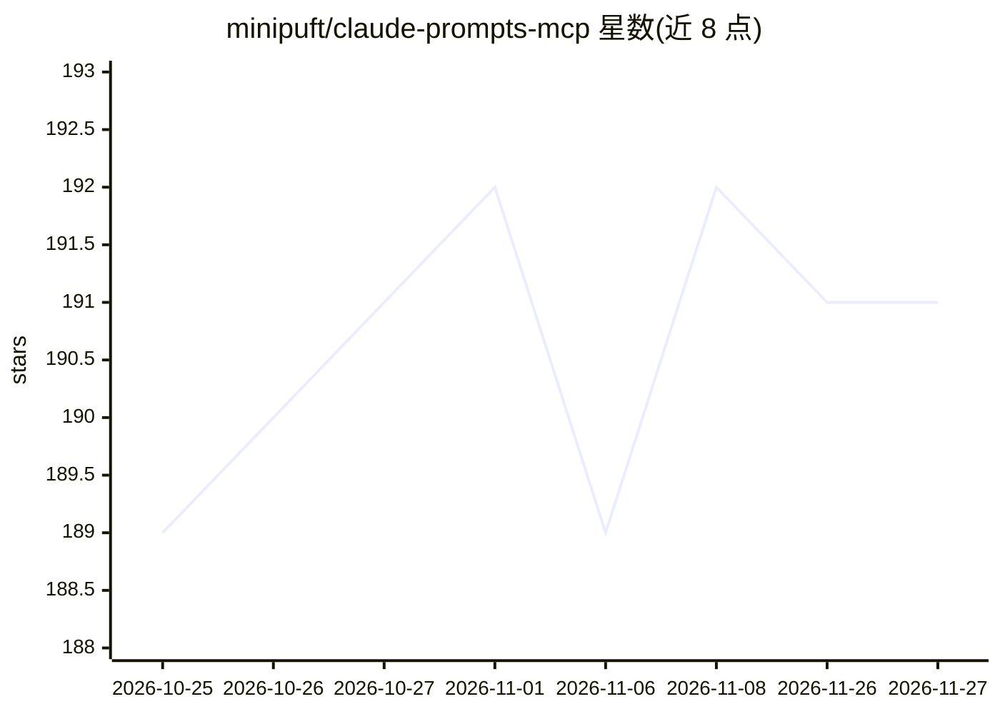

# minipuft/claude-prompts-mcp

⭐ 191 · TypeScript · MIT · 推送 2026-11-23 · [GitHub](https://github.com/minipuft/claude-prompts-mcp) · [官网](https://github.com/minipuft/claude-prompts-mcp/tree/main/docs) · 个人维护

**为 AI 编码客户端提供可复用提示模板与多步工作流的 MCP 服务器**

以 MCP 服务器形式为 Claude Code、Cursor、Gemini CLI 等 AI 编码客户端补充一层可移植的工作流能力：提供版本化的 YAML 提示模板（>>）、推理框架（^）、验证门（::）、输出风格（#）四种原语，以及将它们串联为多步链的操作符语法；步骤间可执行 shell 命令验证并可自动重试。内置 52 个模板、3 个 MCP 工具，支持热重载与回滚，可将模板导出为各客户端原生技能。MIT 许可，npm 安装。

## 筛选速览

| 维度 | 判定 | 备注 |
|---|---|---|
| AI 角色 | `ai-ecosystem` | LLM/agent 周边工具 |
| 许可风险 | `permissive` | MIT |
| 部署形态 | `library` | 以包/库形式分发 |
| 模型依赖 | — | README 未给出锁定关系 |
| 硬件要求 | — | 无带数字的原话,不猜 |
| 安装摩擦 | `low` | 无编译、无系统依赖或容器化 |
| 成熟度 | — | 结构信号不足 |

## 能力要点

- 四种原语（模板/框架/验证门/风格）加链式操作符语法
- 步骤间 shell 验证门支持固定重试次数与超时预设
- 模板版本化、热重载，可通过 resource_manager 由 AI 自行创建与回滚
- skills:export 将 YAML 模板编译为 Claude Code/Cursor/Codex/OpenCode 原生技能

## 适用场景

- 团队共享与版本化管理常用提示模板
- 把代码审查、测试验证等多步流程串成可复用链
- 在多个 AI 编码客户端间移植同一套提示工作流

## 场景标签

`提示工程` · 领域:Agent 开发

## 证据(README 行号)

> L5: **The portable workflow layer beside your AI coding harness.**
> L8: Claude Prompts adds reusable prompt resources, composable chains, validation gates, and client-native skill export.
> L147: Everything above reaches your client through three MCP tools:

## 星数曲线

2026-10-25 189 → 2026-11-27 191（+2）

---
*卡片 v1 · prompt 1.4 · 生成 2026-11-26 · 置信度 high · 依据 README sha `32ea94cacfed` · [字段定义](../../DATASET.md)*
