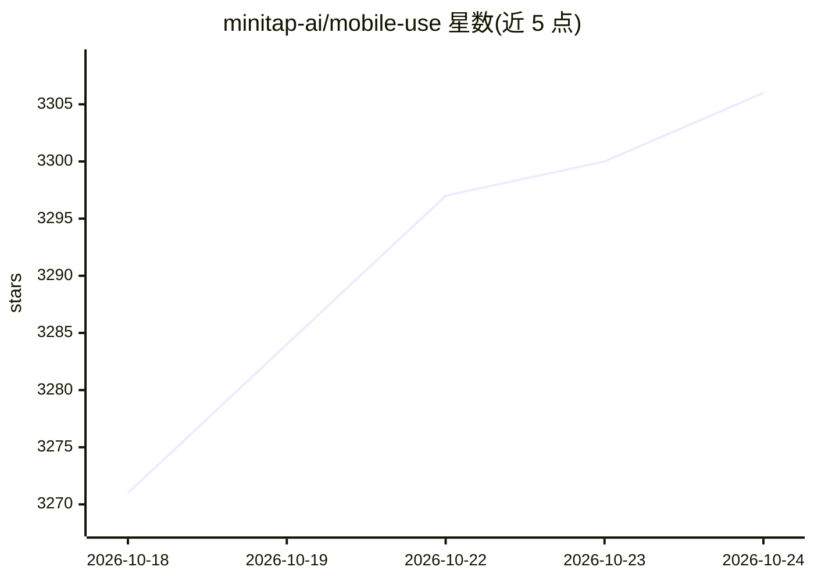

# minitap-ai/mobile-use

⭐ 3,306 · Python · Apache-2.0 · 推送 2026-10-18 · [GitHub](https://github.com/minitap-ai/mobile-use) · [官网](https://minitap.ai) · 组织维护

**用自然语言操控真实 Android/iOS 应用的开源 AI agent**

mobile-use 是一个通过自然语言指令控制 Android 或 iOS 设备的 AI agent：理解用户命令后操作手机 UI 完成任务，如发消息、导航应用、从任意应用抽取数据并按描述结构化输出（如 JSON）。可配置多种 LLM 提供商驱动（OpenAI、Anthropic、MiniMax、OpenRouter 等，也支持 OpenAI 兼容的本地 LLM）。提供 Docker 快速启动脚本与源码手动安装两种方式。设备支持方面：物理 iOS 设备尚未支持，游戏等无障碍树数据缺失的场景效果有限。官方称其完成 AndroidWorld 基准 100% 任务。

## 筛选速览

| 维度 | 判定 | 备注 |
|---|---|---|
| AI 角色 | `ai-native` | 本体是模型或模型工具 |
| 许可风险 | `permissive` | Apache-2.0 |
| 部署形态 | `desktop` | 安装包/桌面程序 |
| 模型依赖 | locked-api |  |
| 硬件要求 | — | 无带数字的原话,不猜 |
| 安装摩擦 | `low` | 无编译、无系统依赖或容器化 |
| 成熟度 | `idea` | |

## 能力要点

- 自然语言控制手机 UI 完成任务
- 从任意应用抽取数据并结构化输出（如 JSON）
- 可配置 OpenAI/Anthropic/MiniMax/OpenRouter 等多种 LLM 提供商及 OpenAI 兼容本地模型
- Docker 一键脚本与源码两种运行方式

## 适用场景

- 让 AI 代替我在手机上完成发消息、导航等操作
- 从手机应用中批量抽取数据并结构化保存
- 自动化移动应用的操作流程（QA 测试等）

## 场景标签

`GUI 自动化` · 领域:效率与自动化

## 证据(README 行号)

> L18: Mobile-use is a powerful, open-source AI agent that controls your Android or IOS device using natural language. It 
> L24: - 🗣️ **Natural Language Control**: Interact with your phone using your native language.
> L26: - 📊 **Data Scraping**: Extract information from any app and structure it into your desired format (e.g., JSON) usin

## 星数曲线

2026-10-18 3,271 → 2026-10-24 3,306（+35）

---
*卡片 v1 · prompt 1.4 · 生成 2026-10-20 · 置信度 mid · 依据 README sha `5bb30968634b` · [字段定义](../../DATASET.md)*
