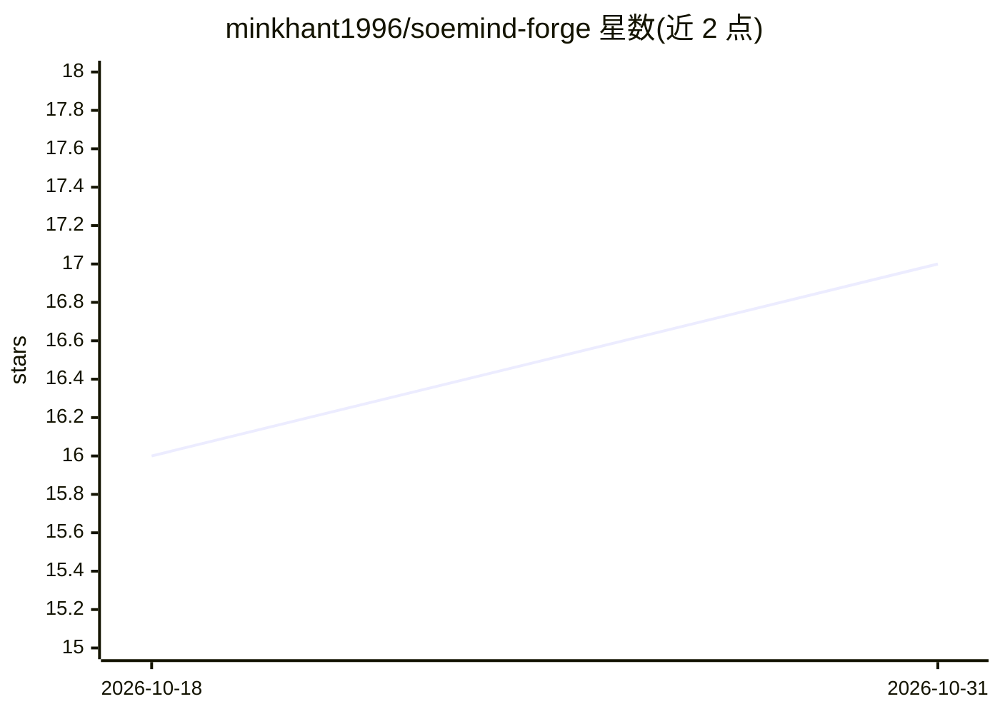

# minkhant1996/soemind-forge

⭐ 17 · TypeScript · MIT · 推送 2026-08-11 · [GitHub](https://github.com/minkhant1996/soemind-forge) · 个人维护

**预算受控的 AI 内容工作室：自然语言生成视频/图像/配音/音乐**

面向创始人、营销人员与小品牌的 AI 内容生成工具包，通过自然语言指令由 AI 编码代理规划、估价、生成并打包视频（Veo 3.1/Omni Flash）、图像（Nano Banana）、配音、音乐、字幕与 30 天内容日历。核心机制：每项目预算上限与支出台账、生成前估价与低价预览、资产注册表锁定角色/产品/声音保证一致性、本地 Remotion 渲染文字。核心提供商为 Google AI Studio（Gemini），可选 OpenRouter（91 模型）与 RunPod（InfiniteTalk 数字人对口型）。运行需 AI 代理 CLI（Claude Code/Codex/Gemini CLI/Hermes/OpenClaw）与 Node.js 18+，无需编程。

## 筛选速览

| 维度 | 判定 | 备注 |
|---|---|---|
| AI 角色 | `ai-native` | 本体是模型或模型工具 |
| 许可风险 | `permissive` | MIT |
| 部署形态 | `library` | 以包/库形式分发 |
| 模型依赖 | — | README 未给出锁定关系 |
| 硬件要求 | — | 无带数字的原话,不猜 |
| 安装摩擦 | `medium` | 含编译或系统依赖之一 |
| 成熟度 | — | 结构信号不足 |

## 能力要点

- 预算上限+支出台账，生成前估价、先低价预览再渲染
- 资产注册表锁定角色/产品/声音，按 ID 复用保证跨片一致
- 本地 Remotion 渲染像素级文字与字幕（$0）
- 支持 Gemini 核心全流程，OpenRouter（91 模型）与 RunPod 为可选附加

## 适用场景

- 用自然语言让 AI 代理制作 TikTok 广告或品牌短片
- 生成带角色一致性的多场景营销视频系列
- 批量产出各平台尺寸合规的图文/视频内容与 30 天内容日历
- 用自定义录音制作无时长上限的数字人对口型视频

## 场景标签

`图像生成` `视频生成` `语音合成` · 领域:内容生成

## 证据(README 行号)

> L3: **Generate AI videos (Veo 3.1), images (Nano Banana), voiceovers, music, and
> L32: **Who this is for:** founders, marketers, and small brands who want professional
> L57: - **Google AI Studio (Gemini)** — the optimized core. Veo video, Gemini 3 image

## 星数曲线

2026-10-18 16 → 2026-10-31 17（+1）

---
*卡片 v1 · prompt 1.4 · 生成 2026-10-30 · 置信度 high · 依据 README sha `7d9d3c215d6a` · [字段定义](../../DATASET.md)*
