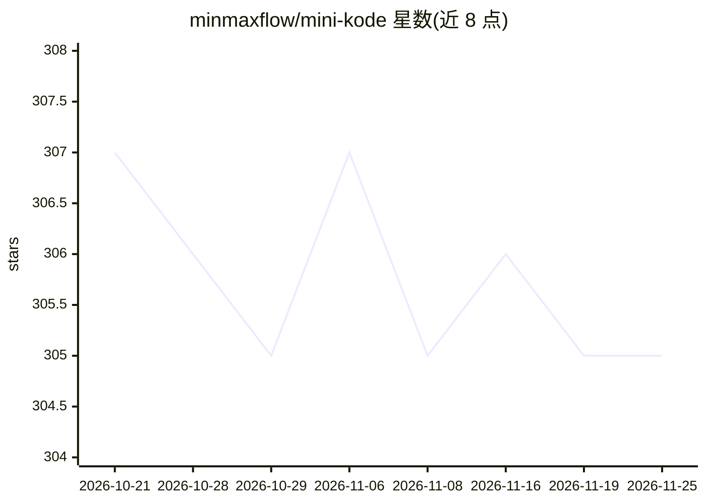

# minmaxflow/mini-kode

⭐ 305 · TypeScript · MIT · 推送 2026-11-03 · [GitHub](https://github.com/minmaxflow/mini-kode) · 个人维护 · 中文 README

**教学用 AI 编码代理 CLI，帮助开发者理解 Coding Agent 架构**

Mini-Kode 是一个教育性质的项目，以约 1.4 万行 TypeScript 代码实现完整 Coding Agent：基于 OpenAI SDK 的 LLM 调用、覆盖文件操作/搜索/命令执行的工具系统、MCP 集成、流式输出的 Agent 循环、人在回路的权限审批、React/Ink 终端 UI，并自动读取项目根目录 AGENTS.md 维护上下文记忆。面向希望理解与魔改现代 AI 编码助手的开发者，附架构文档与代码分析资源。开发需 Bun 与 pnpm。

## 筛选速览

| 维度 | 判定 | 备注 |
|---|---|---|
| AI 角色 | `ai-native` | 本体是模型或模型工具 |
| 许可风险 | `permissive` | MIT |
| 部署形态 | `library` | 以包/库形式分发 |
| 模型依赖 | — | README 未给出锁定关系 |
| 硬件要求 | — | 无带数字的原话,不猜 |
| 安装摩擦 | `low` | 无编译、无系统依赖或容器化 |
| 成熟度 | — | 结构信号不足 |

## 能力要点

- 教育优先设计：OpenAI SDK 之上的清晰架构与完整注释
- 完整工具系统：文件操作、搜索、命令执行统一接口
- MCP 集成与多 LLM 支持（OpenAI 兼容 API，含 DeepSeek/GLM/MiniMax）
- 人在回路的权限审批与流式响应 Agent 循环

## 适用场景

- 学习现代 Coding Agent 的架构与工具系统实现
- 在自己的项目中运行一个可审计的终端 AI 编码助手
- 基于此代码库魔改实验自己的 agent 功能

## 场景标签

`编码 Agent` `教程课程` · 领域:编码与开发

## 证据(README 行号)

> L3: An educational AI coding assistant project that helps you understand and hack modern AI coding assistant systems.
> L9: Mini-Kode is an **educational project** designed to help developers understand modern Coding Agent architecture. We 
> L14: - **⚙️ Multi-LLM Support** - Compatible with OpenAI APIs, including GLM, DeepSeek, MiniMax, and other mainstream mo

## 星数曲线

2026-10-21 307 → 2026-11-25 305（-2）

---
*卡片 v1 · prompt 1.4 · 生成 2026-11-25 · 置信度 high · 依据 README sha `b41a53a6f08b` · [字段定义](../../DATASET.md)*
