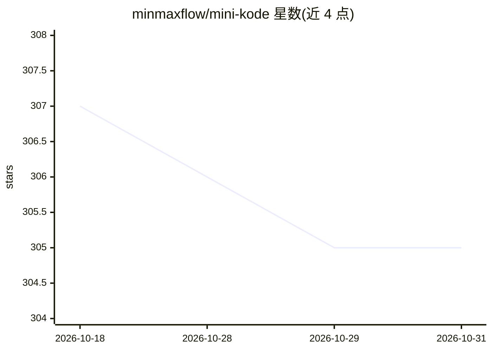

# minmaxflow/mini-kode

⭐ 305 · TypeScript · MIT · 推送 2025-11-04 · [GitHub](https://github.com/minmaxflow/mini-kode) · 个人维护 · 中文 README

**教学用途的 AI 编程代理 CLI，供开发者学习 Agent 架构**

基于 TypeScript 与 OpenAI SDK 构建的终端 AI 编程助手，约 1.4 万行代码，定位为教学项目：帮助开发者理解现代 Coding Agent 的架构。提供统一接口的工具系统（文件操作、搜索、命令执行）、MCP 外部服务器接入、多 LLM 支持（DeepSeek/GLM/OpenAI 兼容 API，DeepSeek 与 GLM 均标注为已测试验证）、流式响应与人工审批的 human-in-the-loop 权限机制，以及基于 React/Ink 的终端界面。通过 npm 全局安装后设置 API key 即可运行，支持交互与非交互模式；会读取项目根目录的 AGENTS.md 作为上下文。

## 筛选速览

| 维度 | 判定 | 备注 |
|---|---|---|
| AI 角色 | `ai-native` | 本体是模型或模型工具 |
| 许可风险 | `permissive` | MIT |
| 部署形态 | `library` | 以包/库形式分发 |
| 模型依赖 | locked-api |  |
| 硬件要求 | — | 无带数字的原话,不猜 |
| 安装摩擦 | `low` | 无编译、无系统依赖或容器化 |
| 成熟度 | — | 结构信号不足 |

## 能力要点

- 统一接口工具系统：文件操作、搜索、命令执行
- MCP 集成可连接外部服务器扩展功能
- 多 LLM 支持：OpenAI 兼容 API，含 GLM、DeepSeek（两者标注已测试）
- 流式响应与 human-in-the-loop 权限审批的 Agent 循环

## 适用场景

- 通过阅读和修改代码学习 Coding Agent 架构
- 在终端用自然语言执行改 bug、文件操作等编程任务
- 接入外部 MCP 服务器扩展代理能力

## 场景标签

`编码 Agent` `教程课程` · 领域:编码与开发

## 证据(README 行号)

> L3: An educational AI coding assistant project that helps you understand and hack modern AI coding assistant systems.
> L15: - **🤖 Agent Loop** - Complete LLM workflow with streaming responses and human-in-the-loop permission approval
> L112: - **OpenAI SDK** - LLM integration (supports DeepSeek/OpenAI/compatible APIs)

## 星数曲线

2026-10-18 307 → 2026-10-31 305（-2）

---
*卡片 v1 · prompt 1.4 · 生成 2026-10-21 · 置信度 high · 依据 README sha `149b87a1ee11` · [字段定义](../../DATASET.md)*
