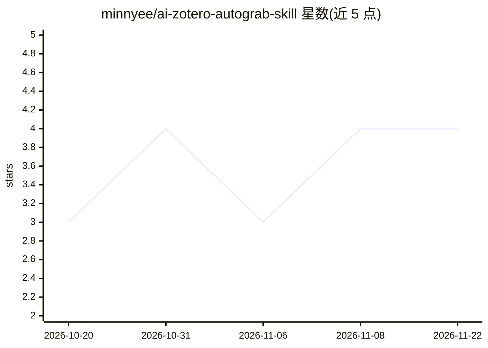

# minnyee/ai-zotero-autograb-skill

⭐ 4 · Python · MIT · 推送 2026-10-10 · [GitHub](https://github.com/minnyee/ai-zotero-autograb-skill) · 个人维护

**AI Agent 技能：文献检索分类并自动导入 Zotero**

一个安装于本地 AI 客户端的 Agent Skill：用户以自然语言下达文献查找任务后，AI 在指定发表范围内检索并筛选论文，从文章证据推导分类，经 DOI 核验后通过 Python 辅助脚本调用 Zotero 本地 API 去重导入。依赖 Python 3.10+（仅标准库）与 Zotero 10+，无需 MCP 服务器或浏览器扩展；导入只增不改，保护已有条目与附件。全文下载不在本技能范围内。

## 筛选速览

| 维度 | 判定 | 备注 |
|---|---|---|
| AI 角色 | `ai-native` | 本体是模型或模型工具 |
| 许可风险 | `permissive` | MIT |
| 部署形态 | `None` |  |
| 模型依赖 | — | README 未给出锁定关系 |
| 硬件要求 | — | 无带数字的原话,不猜 |
| 安装摩擦 | `low` | 无编译、无系统依赖或容器化 |
| 成熟度 | — | 结构信号不足 |

## 能力要点

- 检索、筛选、分类、DOI 核验、去重导入的一条式工作流
- 仅用 Python 标准库与 Zotero 本地 API，无需 MCP 或浏览器扩展
- 导入只添加成员关系，不删除或覆盖已有条目、附件与笔记
- 48 项自动化测试覆盖 DOI 校验、范围控制与授权场景

## 适用场景

- 让本地 AI 客户端按主题自动检索并导入文献到 Zotero
- 按 IEEE 期刊/会议等发表范围做定向文献收集
- 向已有 Zotero 分类追加后续发现并保留历史记录

## 场景标签

`科研工具` · 领域:学习与行业

## 证据(README 行号)

> L3: **AI-powered literature search, dynamic classification, and automatic Zotero import.**
> L7: **An AI Agent Skill that connects literature search and classification to automatic Zotero import.** Tell your AI wh
> L11: - **One connected workflow:** AI searches and classifies; the bundled Python helper verifies supplied bibliographic

## 星数曲线

2026-10-20 3 → 2026-11-22 4（+1）

---
*卡片 v1 · prompt 1.4 · 生成 2026-11-21 · 置信度 mid · 依据 README sha `f48a0629b6ab` · [字段定义](../../DATASET.md)*
