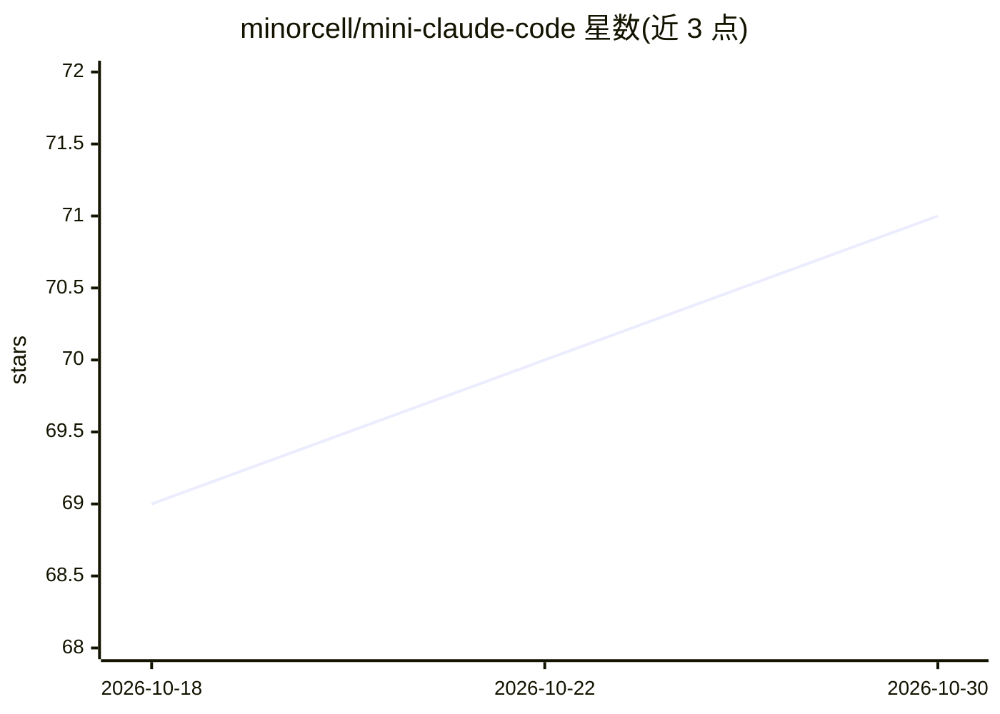

# minorcell/mini-claude-code

⭐ 71 · Go · MIT · 推送 2026-10-26 · [GitHub](https://github.com/minorcell/mini-claude-code) · [官网](https://www.bilibili.com/video/BV1eiwRzPE4n) · 个人维护 · 中文 README

**Go 实现的教学向终端 Code Agent（Mini Claude Code）**

面向 Agent 开发初学者的教学项目：用 Go + OpenAI ADK + BubbleTea 构建终端内 Code Agent，提供代码读取/写入/编辑、glob/grep 搜索、工作区内 bash 执行、todo 管理与 webfetch 抓取等内置工具，过程保留在同一 TUI 会话。统一 provider 接口适配 openai / openai-compatible / anthropic / gemini，通过 ~/.mini-claude-code/config.yaml 配置。附带 Bilibili 视频教学、Issue 教案与交互式教学，配 examples 示例。已知边界包括 bash 默认超时 20 秒、read/webfetch 内容上限 64KB、glob 不支持递归 `**`。

## 筛选速览

| 维度 | 判定 | 备注 |
|---|---|---|
| AI 角色 | `ai-ecosystem` | LLM/agent 周边工具 |
| 许可风险 | `permissive` | MIT |
| 部署形态 | `None` |  |
| 模型依赖 | locked-api |  |
| 硬件要求 | — | 无带数字的原话,不猜 |
| 安装摩擦 | `low` | 无编译、无系统依赖或容器化 |
| 成熟度 | — | 结构信号不足 |

## 能力要点

- 终端 TUI 三区界面（Conversation/Context/Composer），支持消息排队与 @ 文件补全
- 统一 provider 接口适配 openai / openai-compatible / anthropic / gemini
- 9 个内置工具：read/write/edit/list/glob/grep/bash/todo/webfetch
- 工作区约束、安全拦截器与逐步事件广播的 agent loop

## 适用场景

- 跟随视频/教案从零学习 Code Agent 的原理与开发
- 在终端里对本地工作区执行读改文件、搜索与 shell 命令
- 通过 OpenAI-compatible 配置接入 DeepSeek 等网关模型

## 场景标签

`编码 Agent` `教程课程` · 领域:编码与开发

## 证据(README 行号)

> L3: > 本仓库是一个面向 Agent 开发初学者的教学项目仓库，早期使用 TypeScript + AI SDK 实现，现在切换为 Golang + Openai ADK + BubbleTea 实现。
> L11: `mini-claude-code` 是一个 Code Agent 项目。它基于 Go + Bubble Tea，提供终端内的代码读取、工具调用、shell 执行与 todo 管理能力，并将过程保留在同一个 TUI 会话里。
> L18: - `internal/provider`：统一模型接口，适配 `openai` / `openai-compatible` / `anthropic` / `gemini`

## 星数曲线

2026-10-18 69 → 2026-10-30 71（+2）

---
*卡片 v1 · prompt 1.4 · 生成 2026-10-24 · 置信度 high · 依据 README sha `aec51d522e1d` · [字段定义](../../DATASET.md)*
