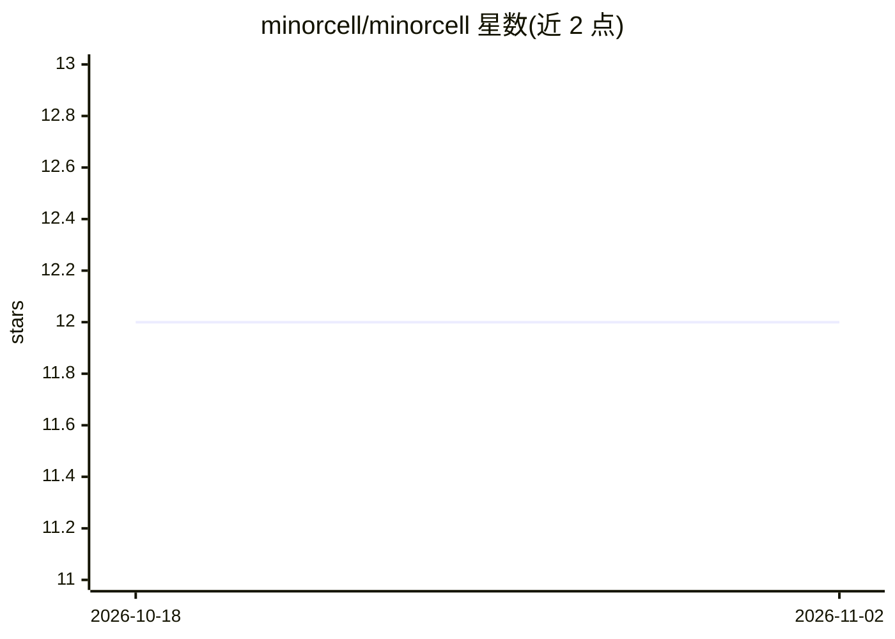

# minorcell/minorcell

⭐ 12 · TypeScript · MIT · 推送 2026-11-01 · [GitHub](https://github.com/minorcell/minorcell) · [官网](https://minorcell.top/) · 个人维护

**minorcell 的个人网站与博客：记录构建与学习**

基于 Next.js 的个人网站与博客，托管于 GitHub Pages，内容以 Markdown 撰写，主题涉及作者在构建过程中的记录与所学。仓库标签显示内容覆盖 AI、LLM、MCP、Claude Code、DeepSeek、AI Agent 等方向。README 仅含一行 contribution snake 说明，具体内容结构与功能无法从 README 验证，安装与运行方式未在可见文本中给出。

## 筛选速览

| 维度 | 判定 | 备注 |
|---|---|---|
| AI 角色 | `ai-knowledge` | 知识聚合/清单类 |
| 许可风险 | `permissive` | MIT |
| 部署形态 | `None` |  |
| 模型依赖 | — | README 未给出锁定关系 |
| 硬件要求 | — | 无带数字的原话,不猜 |
| 安装摩擦 | `low` | 无编译、无系统依赖或容器化 |
| 成熟度 | — | 结构信号不足 |

## 能力要点

- 基于 Next.js 的个人网站与博客，托管于 GitHub Pages
- 内容以 Markdown 撰写
- README 含 contribution snake（贡献动效图）

## 适用场景

- 浏览作者关于 AI/LLM/MCP 的实践记录
- 查看作者在 GitHub 上的项目动态

## 场景标签

 · 领域:个人网站/博客

## 证据(README 行号)

> L1: contribution snake

## 星数曲线

2026-10-18 12 → 2026-11-02 12（+0）

---
*卡片 v1 · prompt 1.4 · 生成 2026-11-01 · 置信度 low · 依据 README sha `b4cba19dc2ca` · [字段定义](../../DATASET.md)*
