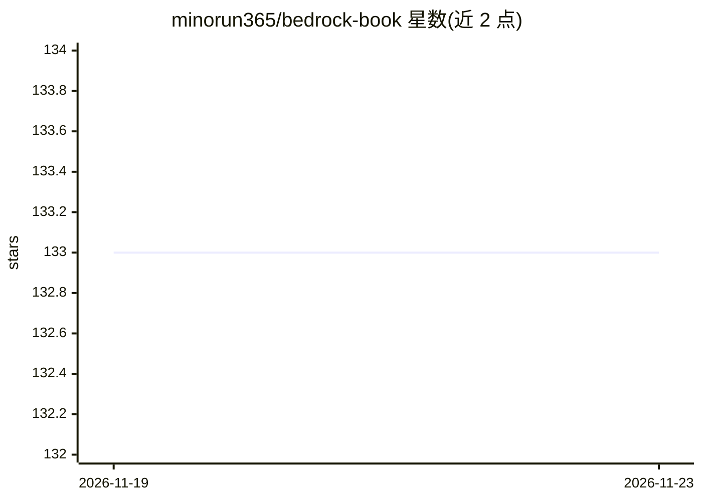

# minorun365/bedrock-book

⭐ 133 · Python · MIT · 推送 2026-11-18 · [GitHub](https://github.com/minorun365/bedrock-book) · [官网](https://www.sbcr.jp/product/4815626440/) · 个人维护

**《Amazon Bedrock 生成AI应用开发入门》书籍配套示例代码库**

书籍「Amazon Bedrock 生成AIアプリ開発入門」的动手实践示例代码仓库，按章节目录存放各章代码与 requirements.txt，方便购书读者复制粘贴运行。刊行后持续维护：补充 Bedrock 模型访问启用步骤变更、Cloud9 停用后的替代环境（SageMaker Studio）、Amazon Nova 版代码、Claude 3.5 Sonnet 等新模型的接入方法，以及 Gradio/Chainlit 漏洞的应对说明。问题通过 Issues 反馈。

## 筛选速览

| 维度 | 判定 | 备注 |
|---|---|---|
| AI 角色 | `ai-knowledge` | 知识聚合/清单类 |
| 许可风险 | `permissive` | MIT |
| 部署形态 | `library` | 以包/库形式分发 |
| 模型依赖 | locked-api |  |
| 硬件要求 | — | 无带数字的原话,不猜 |
| 安装摩擦 | `low` | 无编译、无系统依赖或容器化 |
| 成熟度 | — | 结构信号不足 |

## 能力要点

- 按章节组织的动手实践示例代码与依赖清单
- 刊行后更新：模型启用步骤变更与替代开发环境说明
- 提供 Amazon Nova 版代码（chapter2_nova、chapter3_nova）
- Gradio/Chainlit 漏洞应对与升级版 requirements 文件

## 适用场景

- 跟着该书章节学习用 Bedrock 构建生成式 AI 应用
- 复制书中代码而免去手工录入
- 查询书刊行后 Bedrock 功能与模型的更新应对方法

## 场景标签

`教程课程` · 领域:学习与行业

## 证据(README 行号)

> L1: # 書籍「Amazon Bedrock 生成AIアプリ開発入門」 ハンズオン用サンプルコード
> L18: - `chapter⚫️` ディレクトリ ：各章のハンズオン用コードや、手打ちが大変な設定値などを格納しています。

## 星数曲线

2026-11-19 133 → 2026-11-23 133（+0）

---
*卡片 v1 · prompt 1.4 · 生成 2026-11-19 · 置信度 mid · 依据 README sha `0ec6e2581189` · [字段定义](../../DATASET.md)*
