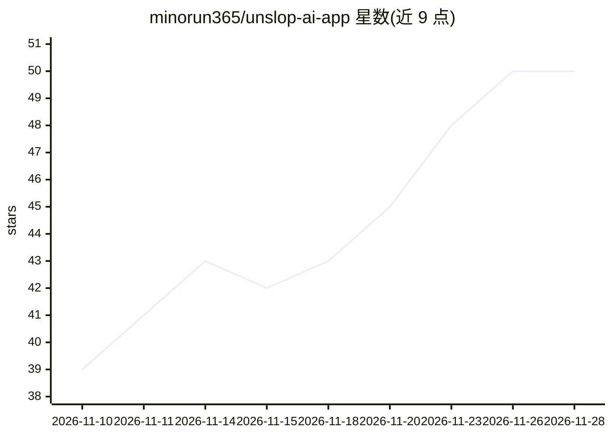

# minorun365/unslop-ai-app

⭐ 50 · JavaScript · Apache-2.0 · 推送 2026-11-25 · [GitHub](https://github.com/minorun365/unslop-ai-app) · 个人维护

**让 AI Agent 生成不像“AI 味”界面的技能集与检查脚本**

面向 Claude Code 等 AI 编码代理的技能（skill）集合：包含信息取舍、避免 AI 风格套路、日文排版与文案规范、Agent 聊天界面作法（思考中/工具执行状态、登录页、演示场景）、iOS Simulator 移动端检查流程，以及一个无依赖的 check-ui.mjs 源码检查脚本，用于检出“AI 味”写法。面向用 Agent 构建 Web 应用的开发者，安装方式为 git clone 到 ~/.claude/skill-repos 后复制 skills 到 ~/.claude/skills。部分内容改编自 Damir Sokolovsky 的 unslop（CC BY 4.0）。

## 筛选速览

| 维度 | 判定 | 备注 |
|---|---|---|
| AI 角色 | `ai-knowledge` | 知识聚合/清单类 |
| 许可风险 | `permissive` | Apache-2.0 |
| 部署形态 | `None` |  |
| 模型依赖 | locked-api |  |
| 硬件要求 | — | 无带数字的原话,不猜 |
| 安装摩擦 | `low` | 无编译、无系统依赖或容器化 |
| 成熟度 | — | 结构信号不足 |

## 能力要点

- 3 个技能：app-ui-design / agent-app-ui / mobile-web-check
- check-ui.mjs 无依赖检查脚本，可扫描源码中的 AI 风格写法
- 覆盖日文排版规范与 iOS Simulator 移动端验证流程
- 通过自然语言请求即可让 Claude 自行调用技能与脚本

## 适用场景

- 让 AI Agent 生成的界面避免模板化的 AI 风格
- 构建 Agent 聊天界面时规范思考中/工具执行等状态显示
- 上线前用检查脚本与移动端流程核验页面

## 场景标签

`提示工程` · 领域:Agent 开发

## 证据(README 行号)

> L5: Webアプリの画面を「AIが作った感じ」にしないための規則と検査スクリプトです。AIエージェント（Claude Code など）に読ませるスキルの形にしてあり、人が読んでもそのまま使えます。
> L13: ## 主な機能
> L20: |`tools/check-ui.mjs`|画面のソースから、AIらしく見える書き方を拾う検査スクリプト（依存なし）|

## 星数曲线

2026-11-10 39 → 2026-11-28 50（+11）

---
*卡片 v1 · prompt 1.4 · 生成 2026-11-18 · 置信度 high · 依据 README sha `21144a7f3b6f` · [字段定义](../../DATASET.md)*
