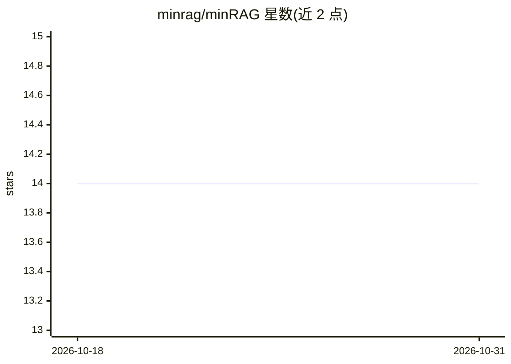

# minrag/minRAG

⭐ 14 · Go · AGPL-3.0 · 推送 2026-06-04 · [GitHub](https://github.com/minrag/minRAG) · [官网](https://gitee.com/minrag/minrag) · 组织维护 · 中文 README

**零安装、双击即用的轻量 RAG 知识库系统（≤1万行）**

用 Go 实现的 RAG 系统，声称代码不超过 1 万行，无需安装、双击可启动。提供 FTS5 BM25 全文检索与 Vec 向量检索、Markdown/Tika 文档解析、切块、嵌入、重排、Prompt 构建、对话记忆等组件，以 Pipeline 方式编排并支持扩展。支持 OpenAI 规范及 Gitee AI（默认，每日 100 次免费调用）、腾讯云 LKE、百度千帆、阿里云百炼、字节火山引擎等平台。默认端口 738，自带中英文后台管理界面；文档解析需另配 markitdown 或 Tika 服务，开发编译需 CGO 环境。

## 筛选速览

| 维度 | 判定 | 备注 |
|---|---|---|
| AI 角色 | `ai-native` | 本体是模型或模型工具 |
| 许可风险 | `viral` | AGPL-3.0 |
| 部署形态 | `desktop` | 安装包/桌面程序 |
| 模型依赖 | — | README 未给出锁定关系 |
| 硬件要求 | — | 无带数字的原话,不猜 |
| 安装摩擦 | `high` | 编译与系统依赖俱全 |
| 成熟度 | — | 结构信号不足 |

## 能力要点

- 双击启动，无需安装，代码量 ≤10,000 行
- FTS5 BM25 + Vec 向量双检索，Pipeline 组件化编排
- 支持 OpenAI 规范与 Gitee AI/腾讯 LKE/百度千帆/阿里百炼/火山引擎
- 中英文后台管理界面与知识库/文档表结构

## 适用场景

- 个人或小团队快速搭建本地知识库问答站点
- 按 Pipeline 编排文档解析、检索、重排与生成流程
- 切换不同国内 AI 平台作为嵌入/生成后端

## 场景标签

`RAG` `文档问答` · 领域:知识与检索

## 证据(README 行号)

> L4: minRAG is a RAG system built from scratch, pursuing extreme simplicity and power, with no more than 10,000 lines of 
> L5: It uses FTS5 for BM25 full-text search and Vec for vector retrieval. It implements components such as MarkdownConver

## 星数曲线

2026-10-18 14 → 2026-10-31 14（+0）

---
*卡片 v1 · prompt 1.4 · 生成 2026-10-31 · 置信度 high · 依据 README sha `a281a471886d` · [字段定义](../../DATASET.md)*
