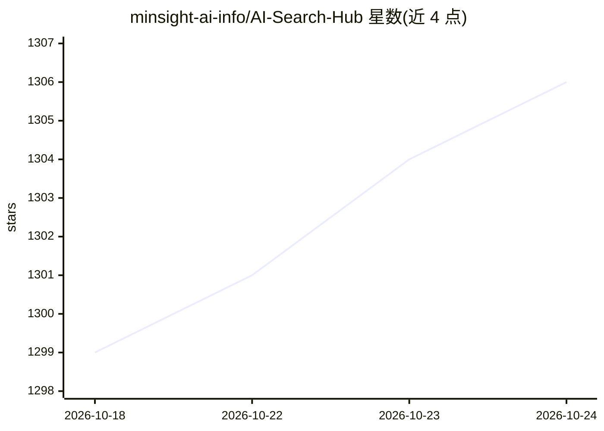

# minsight-ai-info/AI-Search-Hub

⭐ 1,306 · Python · 推送 2026-04-27 · [GitHub](https://github.com/minsight-ai-info/AI-Search-Hub) · 组织维护 · 中文 README

**聚合多平台 AI 搜索能力的开源 Skill，供 Agent 统一调用**

面向 OpenClaw、Claude Code、Cursor 等 Agent 环境的开源 Skill：把 Gemini、Grok、豆包、元宝、LongCat、通义千问、MiniMax、Kimi 等 8 个平台的原生搜索与网页抽取能力聚合为一个统一入口，按问题类型经 ROUTING.md 路由到合适平台，结果统一回收给 Agent 或工作流消费。执行入口为 scripts/run_web_chat.py，以 python3 命令行方式运行；Perplexity、Claude、文心一言列为未来接入。README 同时推广维护方的商业调研产品 NotYet。

## 筛选速览

| 维度 | 判定 | 备注 |
|---|---|---|
| AI 角色 | `ai-ecosystem` | LLM/agent 周边工具 |
| 许可风险 | `none` | — |
| 部署形态 | `None` |  |
| 模型依赖 | locked-api |  |
| 硬件要求 | — | 无带数字的原话,不猜 |
| 安装摩擦 | `low` | 无编译、无系统依赖或容器化 |
| 成熟度 | — | 结构信号不足 |

## 能力要点

- 已接入 8 个平台（Gemini/Grok/豆包/元宝/LongCat/通义千问/MiniMax/Kimi）作为核心搜索入口
- 一次提问分发多平台，Agent 按问题类型自动路由（ROUTING.md）
- 通过 python3 scripts/run_web_chat.py 指定站点与 prompt 执行搜索
- 覆盖抖音、微信公众号、微博、B站等中文平台数据与指定链接抓取

## 适用场景

- 让我的 Agent 一次提问同时查询多个 AI 搜索平台
- 通过豆包/元宝等平台获取抖音、微信公众号等中文数据
- 给一个链接让平台完成抓取、清洗与结构化整理后回传工作流

## 场景标签

`语义搜索` `网页抓取` · 领域:效率与自动化

## 证据(README 行号)

> L33: AI Search Hub 是一个开源 Skill，用来把分散在不同 AI 平台里的搜索能力、网页抽取能力，以及它们背后各自公司的原生数据世界，整理成一个可复用的搜索与抽取中枢。
> L86: **当前已接入：`Gemini` / `Grok` / `豆包` / `元宝` / `LongCat` / `通义千问` / `MiniMax` / `Kimi`**
> L183: 最终结果不是停留在浏览器页面，而是成为 Agent、研究系统、监控流程或自动化链路里的可复用输入。

## 星数曲线

2026-10-18 1,299 → 2026-10-24 1,306（+7）

---
*卡片 v1 · prompt 1.4 · 生成 2026-10-21 · 置信度 high · 依据 README sha `2253542c8d3e` · [字段定义](../../DATASET.md)*
