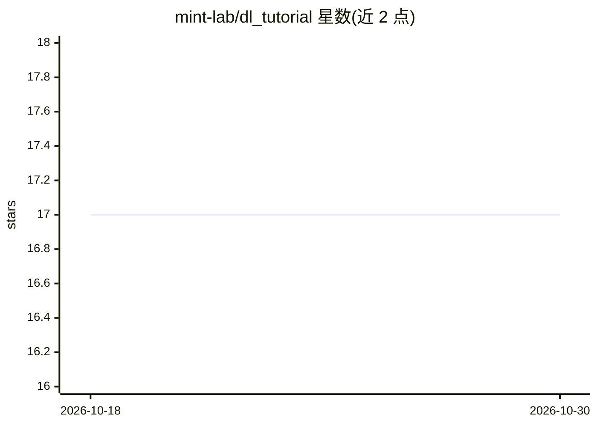

# mint-lab/dl_tutorial

⭐ 17 · 推送 2026-09-08 · [GitHub](https://github.com/mint-lab/dl_tutorial) · 组织维护

**面向本科生的机器学习与深度学习入门教程（幻灯片+示例代码）**

SEOULTECH 教学用 ML/DL 教程仓库，含讲义幻灯片与配套示例代码。ML 部分基于 scikit-learn，覆盖分类、回归、聚类与乳腺癌分类实验；DL 部分基于 PyTorch，覆盖张量操作、自动微分、梯度下降、神经网络、CNN（MNIST）、RNN（Name2Lang）及 YOLO 目标检测实验。示例按幻灯片顺序排列，含骨架代码供练习改进结构与超参数。通过 git clone 或 ZIP 下载获取，先修内容在另一仓库 Programming Meets Mathematics。

## 筛选速览

| 维度 | 判定 | 备注 |
|---|---|---|
| AI 角色 | `ai-knowledge` | 知识聚合/清单类 |
| 许可风险 | `none` | — |
| 部署形态 | `None` |  |
| 模型依赖 | — | README 未给出锁定关系 |
| 硬件要求 | — | 无带数字的原话,不猜 |
| 安装摩擦 | `low` | 无编译、无系统依赖或容器化 |
| 成熟度 | — | 结构信号不足 |

## 能力要点

- ML 与 DL 两套讲义幻灯片，配套按序排列的示例代码
- scikit-learn 覆盖分类/回归/聚类/交叉验证实验
- PyTorch 覆盖自动微分、梯度下降、CNN、RNN 与 YOLO 检测实验
- 示例提供骨架代码，练习目标为改进结构与超参数

## 适用场景

- 初学者跟随幻灯片与代码动手学习 ML/DL 基础
- 课程实验中基于骨架代码调参改进模型
- 查找 scikit-learn 与 PyTorch 的入门级示例实现

## 场景标签

`教程课程` · 领域:学习与行业

## 证据(README 行号)

> L2: _Machine Learning and Deep learning Tutorial_ (shortly _ML/DL Tutorial_) has been initiated to teach undergraduate s
> L11: * Machine Learning with scikit-learn
> L12: * Deep Learning with PyTorch

## 星数曲线

2026-10-18 17 → 2026-10-30 17（+0）

---
*卡片 v1 · prompt 1.4 · 生成 2026-10-29 · 置信度 high · 依据 README sha `c15be9b2f2c0` · [字段定义](../../DATASET.md)*
