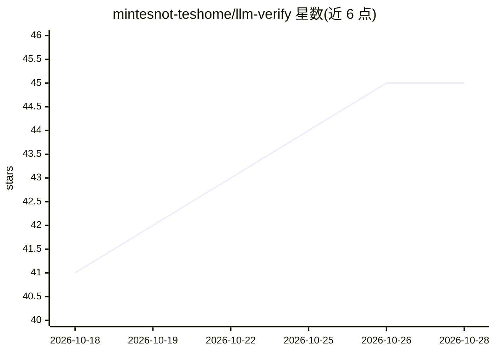

# mintesnot-teshome/llm-verify

⭐ 45 · Python · MIT · 推送 2026-09-21 · [GitHub](https://github.com/mintesnot-teshome/llm-verify) · 个人维护

**检测虚假 LLM API：通过行为指纹验证接口是否真在供宣称的模型**

基于 FastAPI 的 Python 工具，面向需要核验 LLM API 真实性的开发者与买家。对可疑 API 运行 32 个取证提示（身份探针、能力测试、风格分析），从延迟、token 用量、词汇与格式等维度生成行为指纹；可与官方基线对比输出 MATCH/MISMATCH/INCONCLUSIVE 判定，无官方 key 时也可做可疑侧单独分析。提供深度分析接口自动输出 FRAUD_DETECTED 等分级报告；采用 fail-closed 证据规则（至少 8 次成功探针、80% 成功率），明确声明行为指纹是概率性的，不能密码学证明模型身份。

## 筛选速览

| 维度 | 判定 | 备注 |
|---|---|---|
| AI 角色 | `ai-ecosystem` | LLM/agent 周边工具 |
| 许可风险 | `permissive` | MIT |
| 部署形态 | `None` |  |
| 模型依赖 | locked-api |  |
| 硬件要求 | — | 无带数字的原话,不猜 |
| 安装摩擦 | `low` | 无编译、无系统依赖或容器化 |
| 成熟度 | — | 结构信号不足 |

## 能力要点

- 32 个取证提示覆盖身份探针、能力测试与风格分析
- 多维评分：延迟、token 用量、词汇、格式模式
- 一键深度分析输出按严重度排序的欺诈报告
- fail-closed 证据规则：探针失败不产生清洁判定

## 适用场景

- 核验转售商提供的 Claude/ChatGPT API 是否偷换为廉价模型
- 对比可疑 API 与官方基线的行为指纹
- 无需官方 key 时对可疑 API 单独提取欺诈信号

## 场景标签

`模型评测` · 领域:评测与运维

## 证据(README 行号)

> L15: **LLM Verify** catches this by running behavioral fingerprinting benchmarks — a suite of prompts designed to reveal
> L56: |POST|`/api/v1/analysis/deep`|**Run deep analysis — full fraud report**|

## 星数曲线

2026-10-18 41 → 2026-10-28 45（+4）

---
*卡片 v1 · prompt 1.4 · 生成 2026-10-25 · 置信度 high · 依据 README sha `944947a2d149` · [字段定义](../../DATASET.md)*
