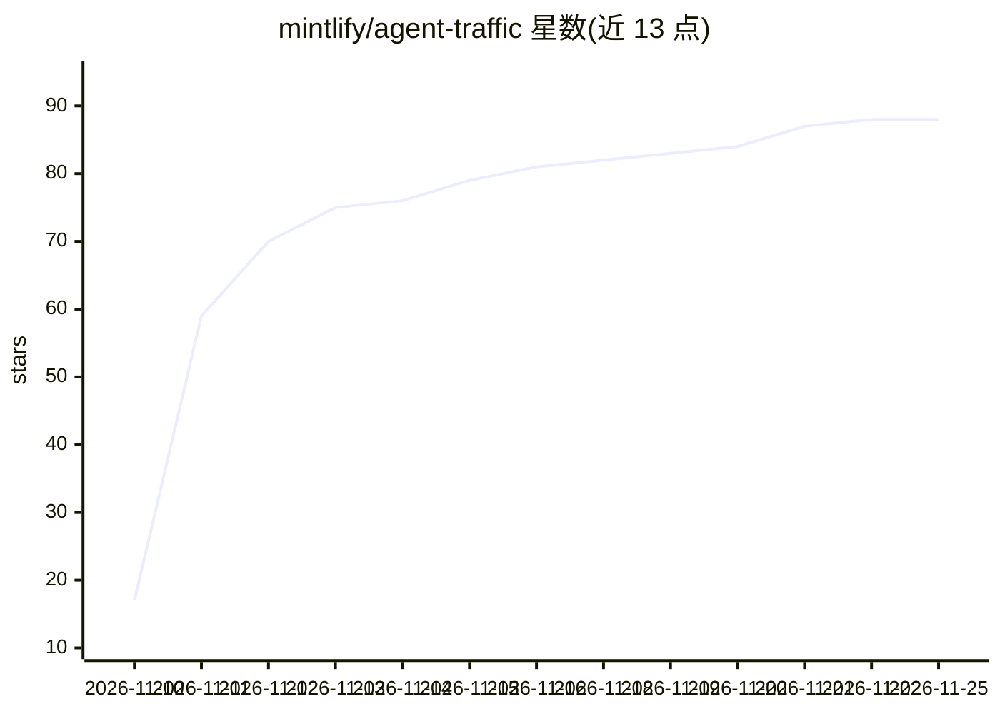

# mintlify/agent-traffic

⭐ 88 · TypeScript · MIT · 推送 2026-11-10 · [GitHub](https://github.com/mintlify/agent-traffic) · [官网](https://agent-traffic.mintlify.site) · 组织维护

**区分人类与 AI 代理/爬虫/机器人的请求分类库**

Mintlify 开源的流量分类库：提供经过测试的 user agent、请求头与官方验证来源数据集，配一个小型分类器 classify()，将请求分为 agent（AI 产品实时取页）、ai-crawler、搜索 crawler、bot、human 等类别。通过运营商公布的 IP 段验证 GPTBot 等爬虫真伪并捕获冒充者，借助 Accept 头偏好 markdown 等信号识别伪装成浏览器的代理。零依赖，可在 Node/Bun/Deno/Cloudflare Workers/Vercel Edge 运行，另提供每类一个正则与纯 JSON 数据集，并附 Claude Code/Cursor 等 agent 可用的 skill 安装方式。

## 筛选速览

| 维度 | 判定 | 备注 |
|---|---|---|
| AI 角色 | `ai-ecosystem` | LLM/agent 周边工具 |
| 许可风险 | `permissive` | MIT |
| 部署形态 | `library` | 以包/库形式分发 |
| 模型依赖 | — | README 未给出锁定关系 |
| 硬件要求 | — | 无带数字的原话,不猜 |
| 安装摩擦 | `low` | 无编译、无系统依赖或容器化 |
| 成熟度 | — | 结构信号不足 |

## 能力要点

- classify() 输出 category/kind/verified/confidence，每个结果附带解释
- 按运营商（OpenAI/Anthropic/Google 等）公布 IP 段验证爬虫并识别冒充者
- Accept 头偏好 markdown 等信号识别伪装浏览器的代理
- 零依赖，数据集可作纯 JSON 导出用于其他语言或 SQL

## 适用场景

- 统计文档站流量中 AI 代理与爬虫的占比与种类
- 在 Cloudflare Worker 等边缘环境拦截冒充 GPTBot 的请求
- 对已有日志的 user agent 做离线分类（ClickHouse/DuckDB/Postgres）

## 场景标签

`网络安全` · 领域:学习与行业

## 证据(README 行号)

> L3: Tell agents, AI crawlers, search crawlers and bots apart from people.
> L9: So we built our own. We studied our traffic, tested the existing open-source bot lists against it, and kept track of
> L30: - A curated, tested dataset of the user agents, headers and official verification sources of real agents and crawle

## 星数曲线

2026-11-10 17 → 2026-11-25 88（+71）

---
*卡片 v1 · prompt 1.4 · 生成 2026-11-18 · 置信度 high · 依据 README sha `79eacbaf737a` · [字段定义](../../DATASET.md)*
