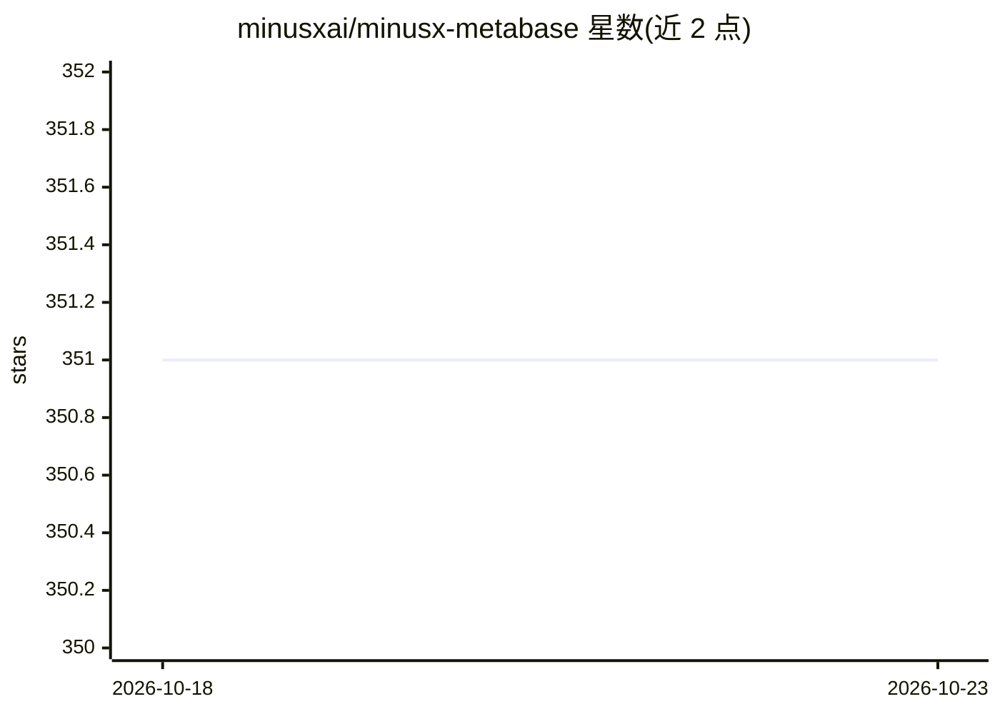

# minusxai/minusx-metabase

⭐ 351 · TypeScript · MIT · 推送 2026-06-12 · [GitHub](https://github.com/minusxai/minusx-metabase) · [官网](https://minusx.ai) · 组织维护

**嵌入 Metabase 的 AI 数据分析师浏览器扩展**

以 Chrome 扩展形式加装到 Metabase 的 AI 侧边聊天助手：接收自然语言指令后，利用 Metabase 内已有的业务上下文（含历史查询与当前 Dashboard 上下文）回答业务问题，并支持通过追问深入挖掘。用户可在 Data catalogs 中自定义指标、维度与子查询，精确控制模型可见的上下文。提供官方 Playground 试用环境，本地开发需参考仓库内的 setup guide。

## 筛选速览

| 维度 | 判定 | 备注 |
|---|---|---|
| AI 角色 | `ai-native` | 本体是模型或模型工具 |
| 许可风险 | `permissive` | MIT |
| 部署形态 | `None` |  |
| 模型依赖 | — | README 未给出锁定关系 |
| 硬件要求 | — | 无带数字的原话,不猜 |
| 安装摩擦 | `low` | 无编译、无系统依赖或容器化 |
| 成熟度 | — | 结构信号不足 |

## 能力要点

- 以 Chrome 扩展形式加装到 Metabase
- 回答时利用 Metabase 中的业务上下文、历史查询与 Dashboard 上下文
- 可通过 Data catalogs 自定义指标/维度/子查询控制模型上下文
- 提供 Playground 试用环境

## 适用场景

- 用自然语言向 Metabase 仪表盘提问并获得回答
- 通过追问对业务数据做深入分析
- 在 Metabase 内复用已有业务定义获得一致性答案

## 场景标签

`数据分析` · 领域:效率与自动化

## 证据(README 行号)

> L3:  MinusX is an AI Analyst that you can add on to your Metabase and helps you reliably answer any business question in
> L16: MinusX adds an AI side-chat to your Metabase. When given an instruction, MinusX uses your business context already 

## 星数曲线

2026-10-18 351 → 2026-10-23 351（+0）

---
*卡片 v1 · prompt 1.4 · 生成 2026-10-21 · 置信度 high · 依据 README sha `419d0adf3ff1` · [字段定义](../../DATASET.md)*
