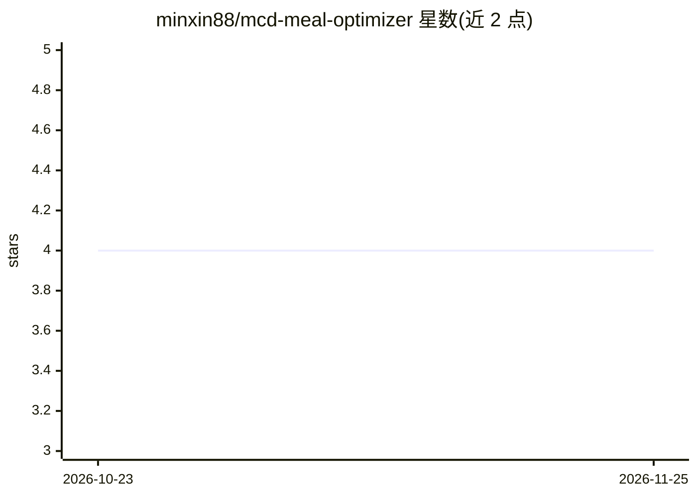

# minxin88/mcd-meal-optimizer

⭐ 4 · Python · MIT · 推送 2026-10-13 · [GitHub](https://github.com/minxin88/mcd-meal-optimizer) · 个人维护 · 中文 README

**面向麦当劳点餐人群的预算热量蛋白质套餐组合优化 Skill**

一个运行在 WorkBuddy 上的开源 Skill：通过麦当劳 MCP 获取菜单、营养与优惠券数据，由本地 Python 引擎（仅标准库）按预算、热量、蛋白质约束枚举候选套餐，输出价格最低、营养目标匹配、每元蛋白质量三种排序。离线演示无需 MCP Token、联网或第三方包；真实使用需申请麦当劳 MCP Token 并在 WorkBuddy 中配置 MCP。本地求解不调用大模型，自然语言交互由 WorkBuddy 承担。

## 筛选速览

| 维度 | 判定 | 备注 |
|---|---|---|
| AI 角色 | `ai-enhanced` | 去掉 AI 部分产品仍成立 |
| 许可风险 | `permissive` | MIT |
| 部署形态 | `library` | 以包/库形式分发 |
| 模型依赖 | — | README 未给出锁定关系 |
| 硬件要求 | — | 无带数字的原话,不猜 |
| 安装摩擦 | `low` | 无编译、无系统依赖或容器化 |
| 成熟度 | — | 结构信号不足 |

## 能力要点

- 本地 Python 引擎仅用标准库，零第三方依赖、零积分消耗
- 通过麦当劳 MCP 读取实时菜单、营养与优惠券数据
- 支持满减、折扣、直减三类券规则，为每套方案选一张券
- 附带离线演示：内置 29 个餐品与 5 张优惠券示例数据

## 适用场景

- 健身控糖人群在热量与蛋白质约束下选麦当劳套餐
- 上班族在固定预算内找最划算的午餐组合
- 多人拼单时凑券搭配避免浪费
- 攒了一批优惠券想知道每张该用在哪一单

## 场景标签

`数据分析` · 领域:效率与自动化

## 证据(README 行号)

> L5: 一个跑在 **WorkBuddy** 上的开源 Skill：通过 **麦当劳 MCP** 获取菜单、营养和优惠券，再由本地 Python 引擎按预算、热量和蛋白质约束筛选候选套餐。真实方案需通过 MCP 核价。
> L21: 输出按三种目标排序：**价格最低、营养目标匹配、每元蛋白质量**。本地求解不调用大模型；理解需求和解释结果的模型交互另计。
> L29: 优惠券是否划算取决于订单构成；同时考虑预算、热量和蛋白质时，手工比较容易遗漏。本项目把自然语言交互交给模型，把候选组合计算交给可检查的脚本。

## 星数曲线

2026-10-23 4 → 2026-11-25 4（+0）

---
*卡片 v1 · prompt 1.4 · 生成 2026-11-21 · 置信度 mid · 依据 README sha `dbcf064a7166` · [字段定义](../../DATASET.md)*
