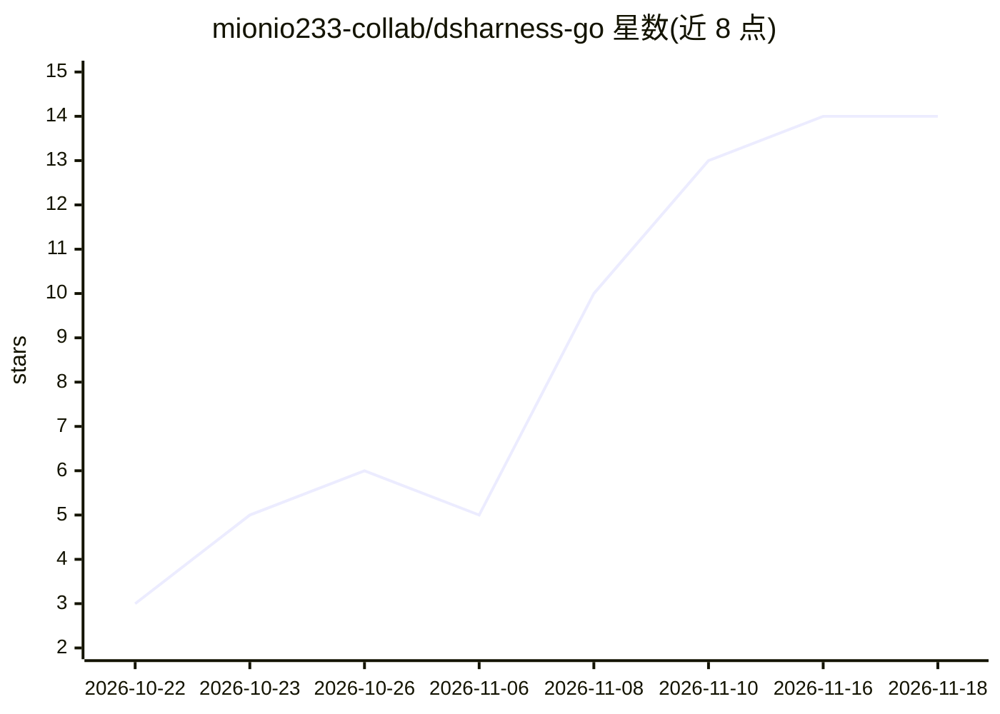

# mionio233-collab/dsharness-go

⭐ 14 · Kotlin · AGPL-3.0 · 推送 2026-10-22 · [GitHub](https://github.com/mionio233-collab/dsharness-go) · [官网](https://dsharnessgo.top/) · 组织维护 · 中文 README

**DeepSeek Harness 的原生 Android 客户端，可本地或 API 跑模型**

为 DeepSeek Harness（DSH）生态提供的原生 Android 客户端（Kotlin + Jetpack Compose，AGPL-3.0）。两种使用方式：局域网扫码或同账号中继连接电脑端 DSH 继续对话、审批任务；或脱离电脑，接入自有 API 供应商（DeepSeek/OpenAI/Anthropic 兼容接口）、内置 llama.cpp 离线 GGUF 推理与 stable-diffusion.cpp 本机生图独立运行。另含基于 Android 无障碍服务的手机自动化 Agent、插件商城与 SKILL.md 技能导入。仅打包 arm64-v8a，需 Android 8.0+，无需 root 与 Linux 模拟器；iOS 版开发中。非 DeepSeek 官方产品。

## 筛选速览

| 维度 | 判定 | 备注 |
|---|---|---|
| AI 角色 | `ai-native` | 本体是模型或模型工具 |
| 许可风险 | `viral` | AGPL-3.0 |
| 部署形态 | `None` |  |
| 模型依赖 | local-ok | 支持本地模型 |
| 硬件要求 | — | 无带数字的原话,不猜 |
| 安装摩擦 | `low` | 无编译、无系统依赖或容器化 |
| 成熟度 | `idea` | |

## 能力要点

- 内置 llama.cpp 端侧推理（GGUF、视觉/多模态）与 stable-diffusion.cpp 本机生图
- 多供应商 API 接入：DeepSeek、OpenAI、Anthropic 兼容接口，可自定义 Base URL
- 基于 Android 无障碍服务的手机自动化 Agent（点击/输入/手势/截图，默认关闭）
- 局域网扫码或同账号中继连接电脑端 DSH，手机端审批任务与继续会话

## 适用场景

- 人不在电脑前时用手机继续电脑端 DSH 的会话并审批任务
- 无电脑场景下用自有 API 或离线 GGUF 模型在手机本地对话与生图
- 让 AI 通过无障碍服务操作手机完成自动化任务
- 隐私敏感场景下完全离线使用本地模型

## 场景标签

`AI 助手` `图像生成` `GUI 自动化` · 领域:效率与自动化

## 证据(README 行号)

> L9: 它让你在手机上连接电脑端 Harness 继续对话，也可以脱离电脑，直接使用自有 API 供应商、离线 GGUF 模型 /
> L61: - 流式回复、工具调用、推理等级（低 / 中 / 高）与任务模式切换；
> L67: - 内置 **llama.cpp** 端侧推理，可下载或导入 GGUF 模型，支持视觉模型与多模态输入；

## 星数曲线

2026-10-22 3 → 2026-11-18 14（+11）

---
*卡片 v1 · prompt 1.4 · 生成 2026-11-18 · 置信度 high · 依据 README sha `8726beb27a37` · [字段定义](../../DATASET.md)*
