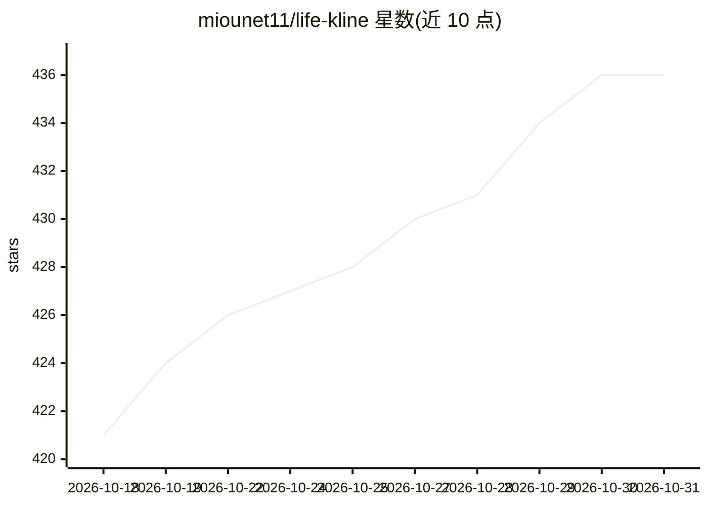

# miounet11/life-kline

⭐ 436 · TypeScript · Apache-2.0 · 推送 2025-12-22 · [GitHub](https://github.com/miounet11/life-kline) · [官网](https://www.life-kline.com) · 组织维护 · 中文 README

**AI 大模型+八字命理的人生运势 K 线可视化 Web 应用**

将传统八字排盘结果转成 1-100 岁的人生运势 K 线图（大运/流年双轨、OHLC 式图表），并由兼容 OpenAI API 格式的大模型生成命理分析报告（性格、事业财运、婚姻、健康等），另含加密货币交易运势分析、名人命盘案例库与积分定价系统。面向普通用户与自托管用户：前端 React 19 + Vite，后端 Express.js + SQLite，八字计算基于 lunar-javascript；自托管需 Node.js 18+ 并配置 API Key。README 声明仅供娱乐与文化研究。

## 筛选速览

| 维度 | 判定 | 备注 |
|---|---|---|
| AI 角色 | `ai-native` | 本体是模型或模型工具 |
| 许可风险 | `permissive` | Apache-2.0 |
| 部署形态 | `None` |  |
| 模型依赖 | — | README 未给出锁定关系 |
| 硬件要求 | — | 无带数字的原话,不猜 |
| 安装摩擦 | `low` | 无编译、无系统依赖或容器化 |
| 成熟度 | — | 结构信号不足 |

## 能力要点

- 八字排盘 + 真太阳时修正 + 1-100 岁运势 K 线图（大运/流年双轨）
- 兼容任何 OpenAI API 格式服务的 AI 深度命理分析
- 自托管支持本地模型（LM Studio、Ollama 等）与积分定价自定义
- 名人命盘案例库与知识殿堂内容模块

## 适用场景

- 输入出生时间地点，用 K 线图查看人生运势走势
- 获取 AI 生成的命理分析报告（性格/事业/婚姻/健康）
- 自托管部署并用自己的 AI API Key 控制数据与成本
- 对比名人命盘案例学习命理知识

## 场景标签

 · 领域:命理娱乐/数据可视化

## 证据(README 行号)

> L20:  基于 AI 大模型 + 传统八字命理，以金融 K 线图的形式展现人生运势轨迹
> L94: ### AI 深度分析
> L162: - OpenAI GPT-4 / GPT-4o / GPT-3.5

## 星数曲线

2026-10-18 421 → 2026-10-31 436（+15）

---
*卡片 v1 · prompt 1.4 · 生成 2026-10-22 · 置信度 high · 依据 README sha `59a761f1723a` · [字段定义](../../DATASET.md)*
