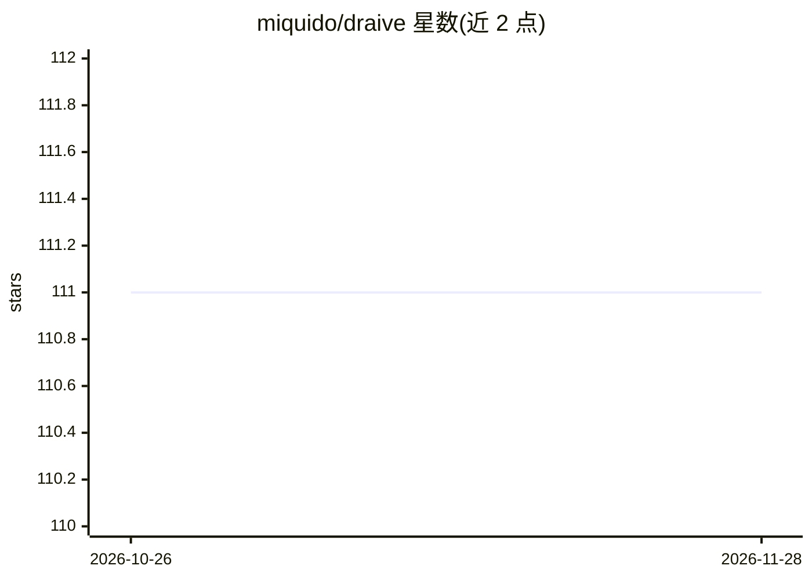

# miquido/draive

⭐ 111 · Python · MIT · 推送 2026-11-26 · [GitHub](https://github.com/miquido/draive) · [官网](https://www.miquido.com/) · 组织维护

**Python LLM 框架：构建带类型化输出与可观测性的生产级 agent**

Draive 是由 Miquido 开发的 Python 框架，面向开发者构建 LLM agent 与工作流。核心机制包括：默认生成经过校验的类型化 State 对象、通过 ctx.scope 提供显式状态与依赖生命周期、以 Python 函数加注解方式定义工具、内置 embeddings 与 VectorIndex 支持 RAG、提供 guardrails（moderation 与运行时评估）以及 OpenTelemetry 兼容的日志/指标/追踪。要求 Python 3.15+，通过 pip 安装，各第三方服务以可选 extras 集成。

## 筛选速览

| 维度 | 判定 | 备注 |
|---|---|---|
| AI 角色 | `ai-ecosystem` | LLM/agent 周边工具 |
| 许可风险 | `permissive` | MIT |
| 部署形态 | `library` | 以包/库形式分发 |
| 模型依赖 | local-ok | 支持本地模型 |
| 硬件要求 | — | 无带数字的原话,不猜 |
| 安装摩擦 | `low` | 无编译、无系统依赖或容器化 |
| 成熟度 | — | 结构信号不足 |

## 能力要点

- 类型化输出：生成经校验的 State 对象而非字符串
- Python 函数加注解即定义 LLM 可调用工具
- 内置 embeddings 与 VectorIndex 支持 RAG 工作流
- 可选 extras 集成 OpenAI/Anthropic/Gemini/Mistral/Cohere/Ollama/vLLM/Bedrock 等

## 适用场景

- 构建自主 agent 与可复用的 Step 工作流管道
- 文档信息抽取、音频与图像等多模态处理
- 为 LLM 应用接入评估、guardrails 与遥测监控

## 场景标签

`Agent 框架` · 领域:Agent 开发

## 证据(README 行号)

> L9: 🏎️ Build production-ready GenAI systems with strict typing, clean architecture, and fast iteration.
> L11: Draive helps teams move from prompt experiments to dependable AI features: typed outputs, tool
> L74: - **Model-Agnostic by Design**: Built-in support for major hosted and self-hosted providers.

## 星数曲线

2026-10-26 111 → 2026-11-28 111（+0）

---
*卡片 v1 · prompt 1.4 · 生成 2026-11-28 · 置信度 high · 依据 README sha `a11e2635e5ae` · [字段定义](../../DATASET.md)*
