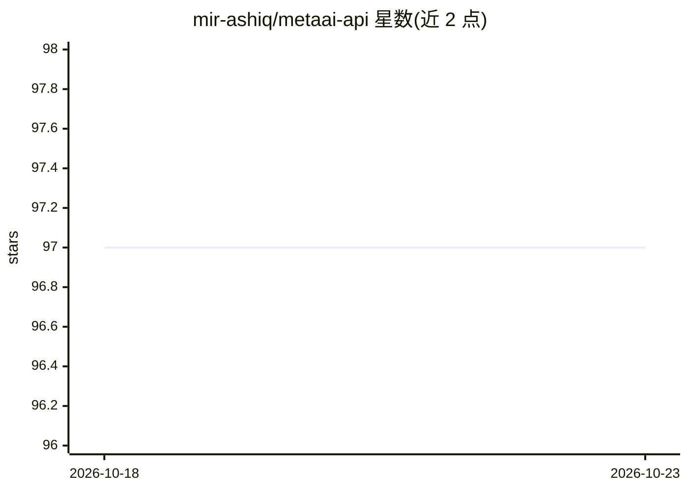

# mir-ashiq/metaai-api

⭐ 97 · Python · MIT · 推送 2026-08-12 · [GitHub](https://github.com/mir-ashiq/metaai-api) · [官网](https://github.com/mir-ashiq/VibesAI-api) · 个人维护

**非官方 Meta AI Python SDK 与 FastAPI 服务器：文生图、对话**

对 Meta AI 逆向封装的 Python SDK 与 REST API 服务器：提供文本生成图片、聊天（Instant/Thinking 模式）、会话管理、按 card ID 获取媒体、DGW 帧重放等方法；视频生成已不可用。v3.0.0 起因 Meta 迁移到 DGW WebSocket 协议，改用 agent-browser 驱动无头 Chrome 实现主要功能。认证依赖浏览器 cookie（datr/ecto_1_sess），无 API key；每张图约 30-40 秒，cookie 会过期，部分地区不可用，属非官方逆向项目。

## 筛选速览

| 维度 | 判定 | 备注 |
|---|---|---|
| AI 角色 | `ai-ecosystem` | LLM/agent 周边工具 |
| 许可风险 | `permissive` | MIT |
| 部署形态 | `self-host` | docker 或自建部署 |
| 模型依赖 | — | README 未给出锁定关系 |
| 硬件要求 | — | 无带数字的原话,不猜 |
| 安装摩擦 | `low` | 无编译、无系统依赖或容器化 |
| 成熟度 | `idea` | |

## 能力要点

- 文本生成图片与聊天，支持 Instant/Thinking 模式
- 通过 agent-browser 驱动无头 Chrome 应对 DGW 协议
- cookie 认证（datr/ecto_1_sess），无需 API key
- FastAPI REST 服务器可部署后供任意语言调用，提供 Docker 部署

## 适用场景

- 在 Python 项目中以 SDK 调用 Meta AI 的聊天与图片生成
- 部署为 REST 服务统一供多语言客户端调用
- 配合脚本批量生成图片或管理 Meta AI 会话

## 场景标签

`图像生成` · 领域:内容生成

## 证据(README 行号)

> L3: Unofficial Python SDK and API server for Meta AI — generate images, chat with Llama, and manage conversations. No AP
> L40: - 🌐 **REST API server** — Deploy once, call from any language
> L140: This SDK uses **browser automation** (via `agent-browser`) to drive a real headless Chrome browser:

## 星数曲线

2026-10-18 97 → 2026-10-23 97（+0）

---
*卡片 v1 · prompt 1.4 · 生成 2026-10-23 · 置信度 high · 依据 README sha `4eee2c68672d` · [字段定义](../../DATASET.md)*
