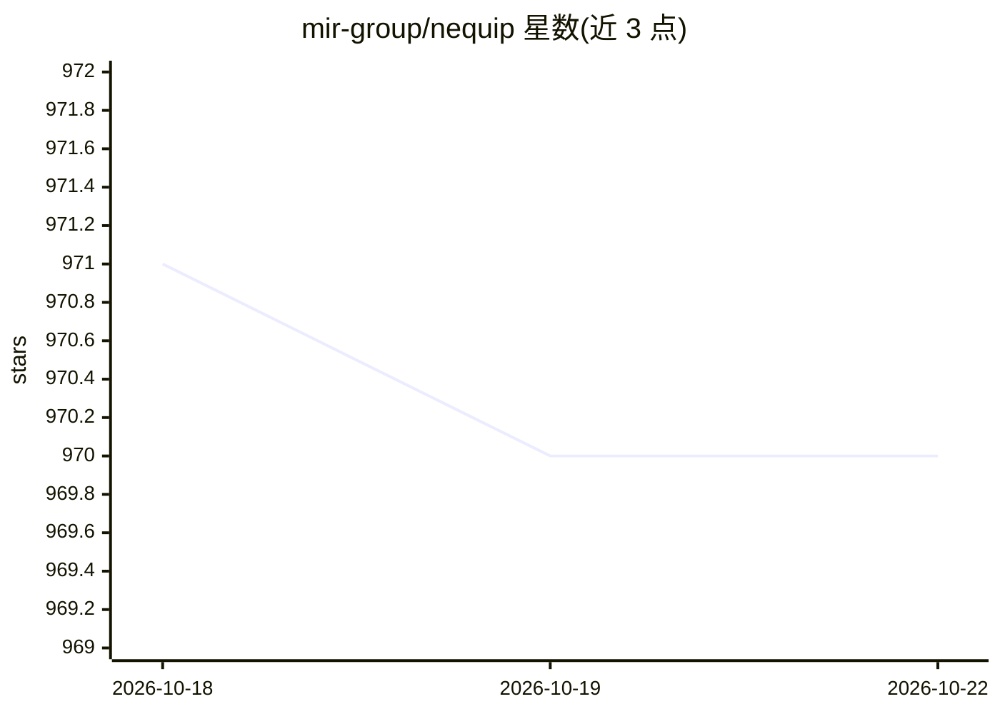

# mir-group/nequip

⭐ 970 · Python · MIT · 推送 2026-10-19 · [GitHub](https://github.com/mir-group/nequip) · [官网](https://pubs.rsc.org/en/content/articlehtml/2026/dd/d5dd00423c) · 组织维护

**构建 E(3)-等变原子间势的深度学习代码，面向分子/材料模拟**

NequIP 是用于训练与运行 E(3)-等变图神经网络原子间势的开源代码：用户在自身数据集上训练势函数模型，也可下载覆盖大部分元素周期表的预训练基础势，直接用于生产模拟或在自有数据上微调。支持编译训练与编译推理、多 GPU 训练、GPU kernel 加速，并提供 ASE calculator 与 LAMMPS pair style 集成；通过扩展包机制可构建自定义架构（如 Allegro）。教程可在 Google Colab 上运行。以 Python 包经 PyPI 分发；2025 年 4 月的 v0.7.0 为重大不兼容更新。

## 筛选速览

| 维度 | 判定 | 备注 |
|---|---|---|
| AI 角色 | `ai-native` | 本体是模型或模型工具 |
| 许可风险 | `permissive` | MIT |
| 部署形态 | `library` | 以包/库形式分发 |
| 模型依赖 | — | README 未给出锁定关系 |
| 硬件要求 | — | 无带数字的原话,不猜 |
| 安装摩擦 | `low` | 无编译、无系统依赖或容器化 |
| 成熟度 | — | 结构信号不足 |

## 能力要点

- E(3)-等变图神经网络原子间势的训练与推理
- 预训练基础势：覆盖大部分元素周期表，可直接使用或微调
- 编译训练/推理、多 GPU 训练与 OpenEquivariance/CuEquivariance GPU 加速
- ASE calculator 集成与 LAMMPS pair style 集成

## 适用场景

- 在我的模拟数据集上训练机器学习力场
- 下载预训练基础势直接跑分子动力学或按需微调
- 通过 ASE 或 LAMMPS 把训练好的势用于生产模拟

## 场景标签

`模型训练` `微调` · 领域:训练与推理

## 证据(README 行号)

> L7: NequIP is an open-source code for building E(3)-equivariant interatomic potentials.
> L24: The NequIP framework provides a family of **foundation potentials** — pre-trained, wide-purpose interatomic potenti

## 星数曲线

2026-10-18 971 → 2026-10-22 970（-1）

---
*卡片 v1 · prompt 1.4 · 生成 2026-10-21 · 置信度 high · 依据 README sha `ac50d9027d35` · [字段定义](../../DATASET.md)*
