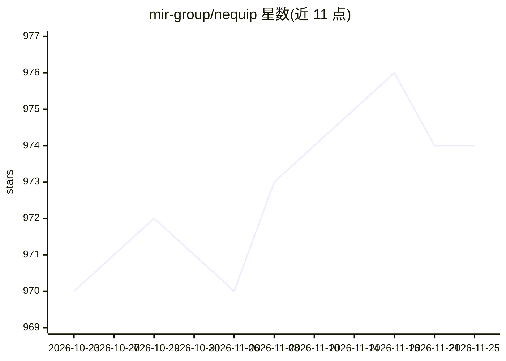

# mir-group/nequip

⭐ 974 · Python · MIT · 推送 2026-11-16 · [GitHub](https://github.com/mir-group/nequip) · [官网](https://pubs.rsc.org/en/content/articlehtml/2026/dd/d5dd00423c) · 组织维护

**构建 E(3) 等变原子间势的机器学习代码**

开源代码包，用于构建 E(3) 等变机器学习原子间势，基于 PyTorch/e3nn 等变神经网络。提供编译训练与编译推理、多 GPU 训练、GPU 内核加速（OpenEquivariance/CuEquivariance），并通过 ASE calculator 与 LAMMPS pair styles 集成到分子动力学模拟。通过扩展包机制支持自定义架构与训练方法（如 Allegro）。另在 nequip.net 提供覆盖大半周期表的预训练 foundation potentials，可直接用于生产模拟或微调。安装方法在文档中给出，配套 Google Colab 教程。

## 筛选速览

| 维度 | 判定 | 备注 |
|---|---|---|
| AI 角色 | `ai-native` | 本体是模型或模型工具 |
| 许可风险 | `permissive` | MIT |
| 部署形态 | `library` | 以包/库形式分发 |
| 模型依赖 | — | README 未给出锁定关系 |
| 硬件要求 | — | 无带数字的原话,不猜 |
| 安装摩擦 | `low` | 无编译、无系统依赖或容器化 |
| 成熟度 | — | 结构信号不足 |

## 能力要点

- 编译训练与编译推理，支持多 GPU 训练
- GPU 内核加速（OpenEquivariance 与 CuEquivariance alpha）
- ASE calculator 与 LAMMPS pair styles 集成
- 扩展包机制，含 Allegro 架构实现

## 适用场景

- 训练自定义的机器学习原子间势用于分子动力学模拟
- 下载预训练 foundation potentials 直接做生产模拟或微调
- 通过 LAMMPS pair style 在 MD 工作流中使用等变势
- 开发自己的等变势扩展架构

## 场景标签

`微调` `模型训练` `推理引擎` · 领域:训练与推理

## 证据(README 行号)

> L7: NequIP is an open-source code for building E(3)-equivariant interatomic potentials.
> L35: - ASE calculator integration and LAMMPS integrations through the pair styles in `pair_nequip_allegro` and our LAMMP
> L39: The NequIP software framework is designed to be flexible and extensible: you can build custom architectures, implem

## 星数曲线

2026-10-23 970 → 2026-11-25 974（+4）

---
*卡片 v1 · prompt 1.4 · 生成 2026-11-25 · 置信度 high · 依据 README sha `776d2a24599d` · [字段定义](../../DATASET.md)*
