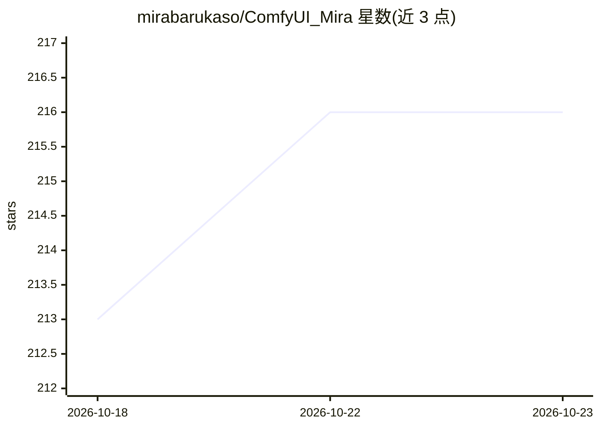

# mirabarukaso/ComfyUI_Mira

⭐ 216 · Python · MIT · 推送 2026-10-21 · [GitHub](https://github.com/mirabarukaso/ComfyUI_Mira) · 个人维护

**ComfyUI 自定义节点集：切分画布生成区域条件遮罩**

面向 ComfyUI 工作流的遮罩与画布工具节点集：按权重布局（如 1,2,1,1;2,4,6）切分画布生成 PNG 颜色遮罩用于区域条件控制（Regional Conditioning），支持嵌套矩形遮罩、四角水印去除遮罩、随机布局生成器、画布尺寸工具及灰度/对比度/色调等图像调整节点。遮罩可设置边缘模糊与强度，输出 HEX/RGB 颜色信息供其他节点使用。通过 ComfyUI Manager 或 git clone 安装，节点已升级适配 ComfyUI V3。

## 筛选速览

| 维度 | 判定 | 备注 |
|---|---|---|
| AI 角色 | `ai-ecosystem` | LLM/agent 周边工具 |
| 许可风险 | `permissive` | MIT |
| 部署形态 | `library` | 以包/库形式分发 |
| 模型依赖 | — | README 未给出锁定关系 |
| 硬件要求 | — | 无带数字的原话,不猜 |
| 安装摩擦 | `low` | 无编译、无系统依赖或容器化 |
| 成熟度 | — | 结构信号不足 |

## 能力要点

- 按权重布局字符串切分画布生成 Tilling/嵌套矩形 PNG 颜色遮罩
- 遮罩支持边缘模糊、强度与相邻遮罩合并（Overlap）
- 随机布局与随机种子生成器节点
- 灰度、对比度、锐化、色调曲线等可链式调用的图像调整节点

## 适用场景

- 在文生图工作流中为不同区域设置独立条件提示词
- 为图片四角生成水印检测与去除遮罩
- 随机生成遮罩布局探索构图变化

## 场景标签

`图像生成` · 领域:内容生成

## 证据(README 行号)

> L6: A custom node for ComfyUI to improve all those custom nodes I feel not comfortable in my workflow.
> L28: Create a `Tilling` PNG image with Color Mask stack for regional conditioning mask.

## 星数曲线

2026-10-18 213 → 2026-10-23 216（+3）

---
*卡片 v1 · prompt 1.4 · 生成 2026-10-22 · 置信度 mid · 依据 README sha `ee1802bd4c30` · [字段定义](../../DATASET.md)*
