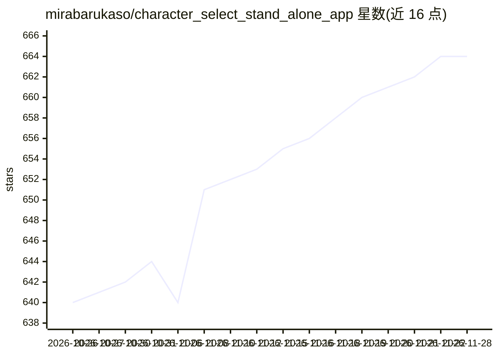

# mirabarukaso/character_select_stand_alone_app

⭐ 664 · JavaScript · MIT · 推送 2026-11-16 · [GitHub](https://github.com/mirabarukaso/character_select_stand_alone_app) · 个人维护

**角色选择与提示词辅助的图像生成桌面端，对接 ComfyUI/WebUI**

基于 Electron 的独立应用，提供角色缩略图列表（thumbList）与半自动标签补全，通过 API 调用 ComfyUI/Forge Neo 生成图像；AI Prompt 面板可经 OpenAI 兼容远程后端或本地 llama.cpp 服务器润色提示词，图像生成本身不调用语言模型。支持 Gallery A/B 对比、Moss 区域框选、面板布局拖拽。需要先部署 ComfyUI_Mira 等 Image API 接口，ComfyUI Desktop 不受支持；A1111 已移出测试列表但仍可工作。

## 筛选速览

| 维度 | 判定 | 备注 |
|---|---|---|
| AI 角色 | `ai-native` | 本体是模型或模型工具 |
| 许可风险 | `permissive` | MIT |
| 部署形态 | `desktop` | 安装包/桌面程序 |
| 模型依赖 | local-ok | 支持本地模型 |
| 硬件要求 | — | 无带数字的原话,不猜 |
| 安装摩擦 | `medium` | 含编译或系统依赖之一 |
| 成熟度 | — | 结构信号不足 |

## 能力要点

- 角色列表与半自动标签补全，thumbList 可从 HuggingFace 自动下载或自建
- AI Prompt 提供三种模板，经 OpenAI 兼容 API 或 llama.cpp 本地服务器调用
- Moss 图像边界框：画布上绘制至多 128 个区域框并合并为 JSON 提示词
- 支持 ComfyUI/Forge Neo 双后端，功能覆盖经验证表格列出

## 适用场景

- 从角色列表选人后用 ComfyUI 或 Forge Neo 生成图像
- 让 AI 按模板把简短描述扩写为扩散模型提示词
- 在同一界面批量对比与挑选生成结果
- 为区域条件（Regional Condition/Couple）绘制分区域提示框

## 场景标签

`图像生成` `提示工程` · 领域:Agent 开发

## 证据(README 行号)

> L2: A Stand Alone App with AI prompt, Semi-auto Tag Complete and ComfyUI/Forge Neo(WebUI) API support.
> L97: ## AI Prompt
> L98: Write or polish a prompt in the AI Prompt panel, then put the result into a prompt box yourself. Image generation d

## 星数曲线

2026-10-26 640 → 2026-11-28 664（+24）

---
*卡片 v1 · prompt 1.4 · 生成 2026-11-24 · 置信度 mid · 依据 README sha `fd15acd3e87e` · [字段定义](../../DATASET.md)*
