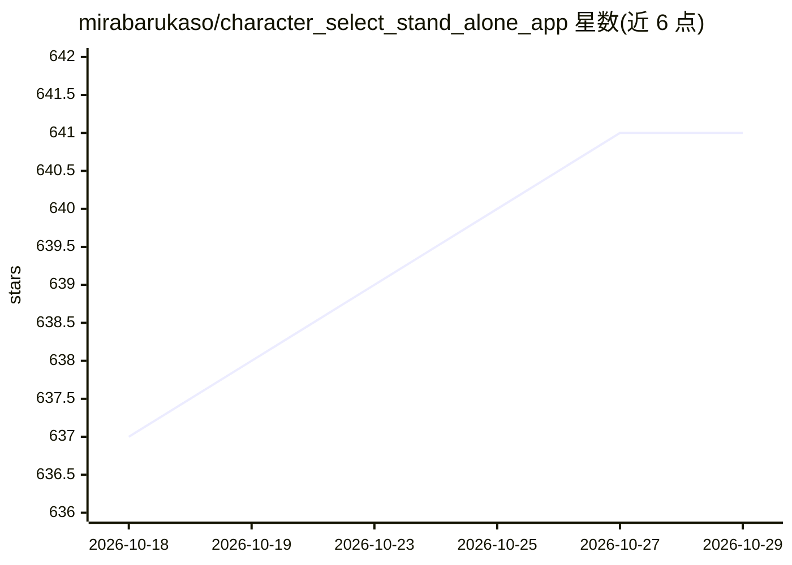

# mirabarukaso/character_select_stand_alone_app

⭐ 641 · JavaScript · MIT · 推送 2026-10-21 · [GitHub](https://github.com/mirabarukaso/character_select_stand_alone_app) · 个人维护

**面向 ComfyUI/Forge 的角色选择与提示词构建桌面应用**

基于 Electron 的独立图像生成前端：内置按模型（waiIllustriousSDXL、waiANIMA 等）组织的角色缩略图列表与半自动标签补全，将选择的角色信息合并进正向提示词，通过 API 提交给 ComfyUI 或 Forge Neo 后端生成图像；支持 Refiner、Regional Condition/Couple、ControlNet/IP Adapter、ADetailer 等工作流特性。附带基于视觉模型的 MiraITU 平铺放大（1.5x-8x，可调 tile 大小优化显存）与本地 ONNX Image Tagger（onnxruntime-node 运行，无需后端但无 GPU 加速）。提供 git clone + npm 源码运行方式与 One-Click 打包。已从支持列表移除 A1111（仍可用但不测试），ComfyUI Desktop 不支持。

## 筛选速览

| 维度 | 判定 | 备注 |
|---|---|---|
| AI 角色 | `ai-ecosystem` | LLM/agent 周边工具 |
| 许可风险 | `permissive` | MIT |
| 部署形态 | `desktop` | 安装包/桌面程序 |
| 模型依赖 | — | README 未给出锁定关系 |
| 硬件要求 | — | 无带数字的原话,不猜 |
| 安装摩擦 | `medium` | 含编译或系统依赖之一 |
| 成熟度 | — | 结构信号不足 |

## 能力要点

- 按模型组织的角色缩略图数据库与半自动标签补全，经 API 驱动 ComfyUI/Forge Neo 生成
- MiraITU：基于视觉模型的内容感知平铺放大（1.5x-8x），8GB 显存可做 1.5x-3x
- Image Tagger 本地 ONNX 运行（WD/CL/Camie 模型），不依赖后端
- 画布 Bounding Box 编辑器，最多 64 个 object/text 区域合并为 JSON 提示词

## 适用场景

- 用 Illustrious/Anima 等 SDXL 系模型时快速选角色并组装提示词出图
- 拖放任意图像做 1.5x-8x 超分辨率放大
- 对生成/本地图像打标签辅助提示词编写
- 双角色/多区域构图通过 Bounding Box 与 Regional Condition 完成

## 场景标签

`图像生成` `提示工程` `图像视频处理` · 领域:Agent 开发

## 证据(README 行号)

> L2: A Stand Alone App with AI prompt, Semi-auto Tag Complete and ComfyUI/Forge Neo(WebUI) API support.
> L10: |Verified|ComfyUI|Forge Neo|
> L217: The Image Tagger running on Node.JS with `onnxruntime-node`. *It DOES NOT require any backend support* But, GPU ac

## 星数曲线

2026-10-18 637 → 2026-10-29 641（+4）

---
*卡片 v1 · prompt 1.4 · 生成 2026-10-21 · 置信度 high · 依据 README sha `570857205ac9` · [字段定义](../../DATASET.md)*
