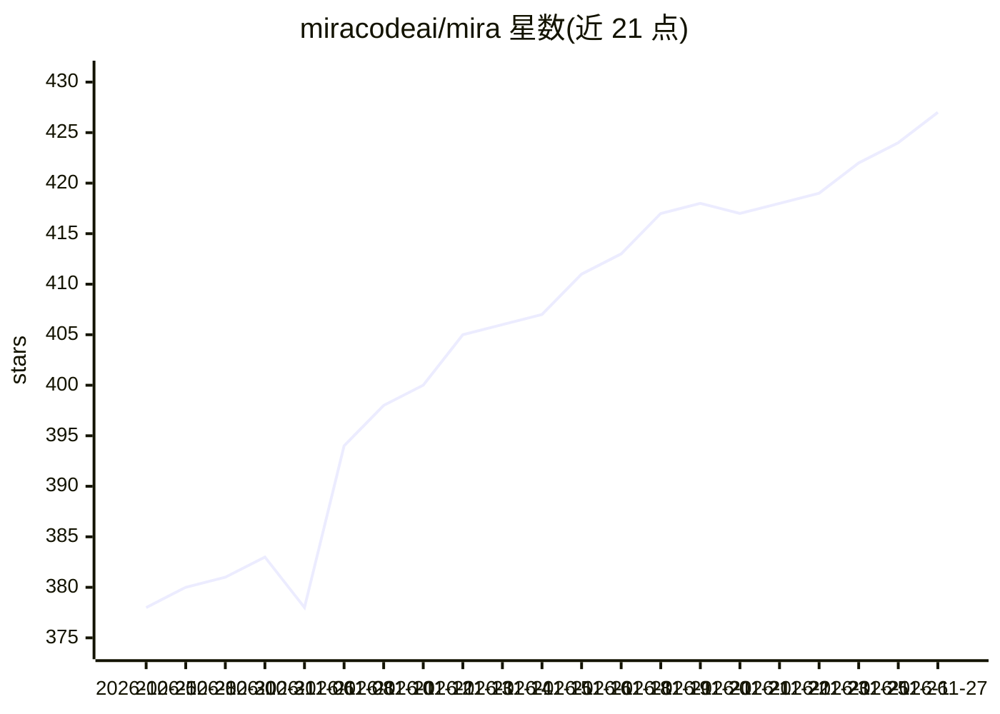

# miracodeai/mira

⭐ 427 · Python · Apache-2.0 · 推送 2026-11-24 · [GitHub](https://github.com/miracodeai/mira) · [官网](https://docs.miracode.ai) · 组织维护

**自托管 AI 代码评审服务：索引化审查 PR 并给出反馈**

Mira 是自托管的 PR 代码评审服务：对每个 pull request 生成评审意见、全库索引的跨文件上下文、PR walkthrough、漏洞扫描（OSV.dev）、依赖图与自定义评审规则，并从已合并 PR 中学习形成团队规则。模型通过 OpenRouter 或任意 OpenAI 兼容端点接入，用户自带 API key；数据存于自有 SQLite/Postgres。支持 GitHub、GitLab、Forgejo/Codeberg、Bitbucket Cloud 的 webhook 自动评审与 `@miracodeai` 行内问答，也可用 CLI 对本地分支运行 `mira review`。

## 筛选速览

| 维度 | 判定 | 备注 |
|---|---|---|
| AI 角色 | `ai-ecosystem` | LLM/agent 周边工具 |
| 许可风险 | `permissive` | Apache-2.0 |
| 部署形态 | `self-host` | docker 或自建部署 |
| 模型依赖 | local-ok | 支持本地模型 |
| 硬件要求 | — | 无带数字的原话,不猜 |
| 安装摩擦 | `low` | 无编译、无系统依赖或容器化 |
| 成熟度 | — | 结构信号不足 |

## 能力要点

- 全库代码索引提供跨文件上下文，而非仅 diff
- 从已合并 PR 的被拒评论与人工评审模式合成团队规则
- 每小时轮询 OSV.dev 做 CVE 扫描，仪表盘提供依赖爆炸半径图
- 支持 Codex CLI 作为本地认证的推理后端

## 适用场景

- 让团队自托管一个对每个 PR 自动出评审意见的服务
- 查询哪些仓库使用了某个有 CVE 的依赖包
- 在合并前检查 PR 之间的冲突风险与重复工作
- 对本地分支在提交前运行评审

## 场景标签

`代码审查` · 领域:编码与开发

## 证据(README 行号)

> L17: Mira reviews your pull requests using your choice of LLM (via OpenRouter, which fronts Anthropic, OpenAI, Google, D
> L21: - **Model agnostic** — Run Claude, GPT, Gemini, DeepSeek, Llama, or any OpenAI-compatible endpoint: OpenRouter, vLL
> L85: Run Mira self-hosted to auto-review every PR and merge request and answer `@miracodeai` questions inline. GitHub (a

## 星数曲线

2026-10-25 378 → 2026-11-27 427（+49）

---
*卡片 v1 · prompt 1.4 · 生成 2026-11-25 · 置信度 mid · 依据 README sha `d5dc9fc57977` · [字段定义](../../DATASET.md)*
