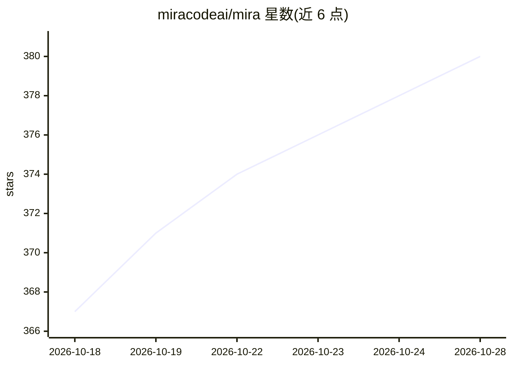

# miracodeai/mira

⭐ 380 · Python · Apache-2.0 · 推送 2026-10-27 · [GitHub](https://github.com/miracodeai/mira) · [官网](https://docs.miracode.ai) · 组织维护

**自托管 AI 代码审查工具：用自带 LLM key 自动审查 PR**

面向工程团队的自托管代码审查服务：以 Docker 部署，接入 GitHub/GitLab/Forgejo，对每个 PR 和合并请求生成审查意见，支持自然语言自定义规则，并从被拒评论与人工审查模式中合成团队规则（learning loop）。模型无关：经 OpenRouter 或直连 vLLM/Ollama/Bedrock 等任意 OpenAI 兼容端点，用户自带 key，按模型商直接付费。附带全仓代码索引、OSV.dev CVE 小时级扫描、依赖与影响面图、逐仓成本遥测的仪表盘。数据存储在自有 SQLite/Postgres。

## 筛选速览

| 维度 | 判定 | 备注 |
|---|---|---|
| AI 角色 | `ai-native` | 本体是模型或模型工具 |
| 许可风险 | `permissive` | Apache-2.0 |
| 部署形态 | `self-host` | docker 或自建部署 |
| 模型依赖 | local-ok | 支持本地模型 |
| 硬件要求 | — | 无带数字的原话,不猜 |
| 安装摩擦 | `low` | 无编译、无系统依赖或容器化 |
| 成熟度 | — | 结构信号不足 |

## 能力要点

- PR 自动审查与置信度阈值、去重、自我批评等降噪机制
- 模型无关：OpenRouter、vLLM、Ollama、Bedrock、Codex CLI 等通道
- 全仓代码索引与跨文件上下文，附组织级包搜索
- 每小时 OSV.dev CVE 扫描与依赖/影响面图仪表盘

## 适用场景

- 自建服务自动审查每个 PR 并在页面内回答提问
- 团队用自然语言定义仓库级/组织级审查规则
- 查询哪些仓库受某 CVE 影响及改动的波及范围

## 场景标签

`代码审查` · 领域:编码与开发

## 证据(README 行号)

> L5:  Self-hosted AI code review. Your code, your dashboard, your LLM key.
> L17: Mira reviews your pull requests using your choice of LLM (via OpenRouter, which fronts Anthropic, OpenAI, Google, D
> L29: - **GitHub, GitLab, and Forgejo** — Auto-reviews every PR and merge request and answers `@miracodeai` questions inl

## 星数曲线

2026-10-18 367 → 2026-10-28 380（+13）

---
*卡片 v1 · prompt 1.4 · 生成 2026-10-21 · 置信度 mid · 依据 README sha `2a088456517d` · [字段定义](../../DATASET.md)*
