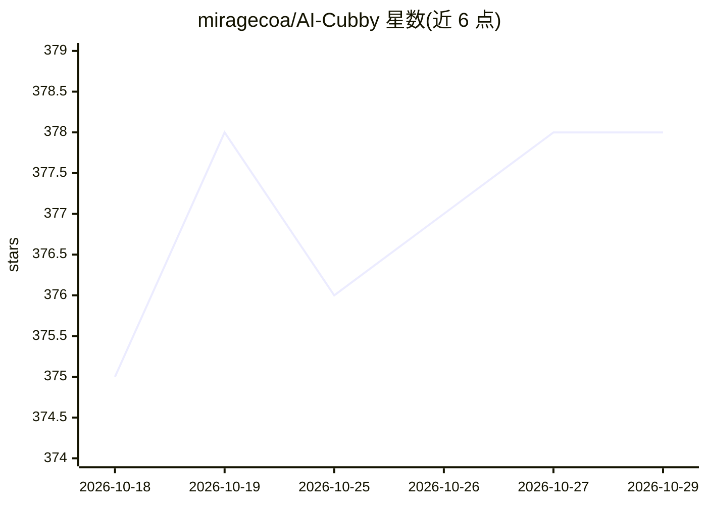

# miragecoa/AI-Cubby

⭐ 378 · Vue · AGPL-3.0 · 推送 2026-10-15 · [GitHub](https://github.com/miragecoa/AI-Cubby) · 个人维护 · 中文 README

**本地优先的文件/程序使用记录与资源管理器，AI 打标签**

基于 Electron 29 + Vue 3 + SQLite 的 Windows 桌面应用：后台静默记录用户打开的文件、桌面快捷方式与启动的进程（使用 fs.watch 与 WMI 事件订阅，无轮询），提供使用次数、运行时长等统计、全文搜索、标签、多配置库与文件夹导入。AI 能力（自然语言搜索、照片批量标注、程序/游戏识别）在 README 中标注为 coming soon，当前核心为使用历史记录器。数据全部本地存储，AGPL-3.0 许可并另提供商业授权通道。

## 筛选速览

| 维度 | 判定 | 备注 |
|---|---|---|
| AI 角色 | `ai-enhanced` | 去掉 AI 部分产品仍成立 |
| 许可风险 | `dual` | AGPL-3.0 |
| 部署形态 | `desktop` | 安装包/桌面程序 |
| 模型依赖 | — | README 未给出锁定关系 |
| 硬件要求 | — | 无带数字的原话,不猜 |
| 安装摩擦 | `low` | 无编译、无系统依赖或容器化 |
| 成熟度 | `idea` | |

## 能力要点

- 后台自动记录打开的文件、快捷方式与进程，零配置
- 使用统计：打开次数、总运行时长、最近打开时间
- 全文本地搜索、标签、置顶/忽略、多配置库
- 数据 100% 本地存储，不上传服务器

## 适用场景

- 找不到半年前用过的某个工具时，一键搜索使用历史
- 把桌面杂物拖入一个文件夹再导入索引，靠搜索而非分类管理
- 追踪游戏和应用的打开次数与运行时长

## 场景标签

 · 领域:桌面生产力/文件管理

## 证据(README 行号)

> L67: ### 3. AI features (coming soon)
> L76: **AI auto-categorization** — use it, let AI organize it:

## 星数曲线

2026-10-18 375 → 2026-10-29 378（+3）

---
*卡片 v1 · prompt 1.4 · 生成 2026-10-21 · 置信度 high · 依据 README sha `229a95053222` · [字段定义](../../DATASET.md)*
