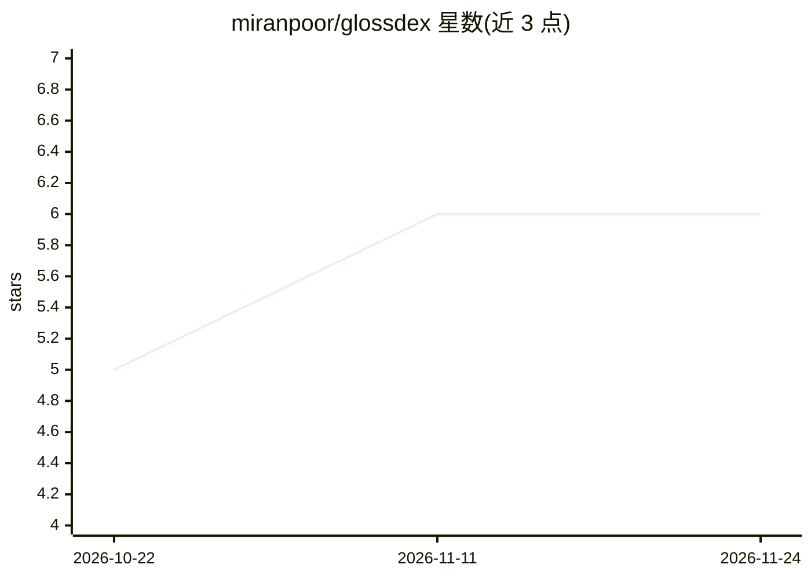

# miranpoor/glossdex

⭐ — · [GitHub]() · 个人维护

**本地照片/文档语义搜索：按证据支持度决定返回几条或不返回**

glossdex 对文件夹内的照片与文档做私有语义搜索：本地模型为每个文件生成短语式 gloss 描述并嵌入，查询时通过噪声底线、证据门、带宽等阈值阶段决定返回条数——常见为一两条，无匹配则返回空。无需训练、点击日志或相关性标注，数据不出本机。依赖 Python 3.9+ 与 Ollama，提供 CLI、本地网页界面与 Python API，含三个适配器接口可替换内容源/描述器/嵌入器。基准测试基于 BEIR 三个公开集合。

## 筛选速览

| 维度 | 判定 | 备注 |
|---|---|---|
| AI 角色 | `ai-native` | 本体是模型或模型工具 |
| 许可风险 | `dual` | — |
| 部署形态 | `library` | 以包/库形式分发 |
| 模型依赖 | local-ok | 支持本地模型 |
| 硬件要求 | — | 无带数字的原话,不猜 |
| 安装摩擦 | `low` | 无编译、无系统依赖或容器化 |
| 成熟度 | — | 结构信号不足 |

## 能力要点

- 证据门控结果集：无匹配时返回空，并对每条结果给出判定解释
- 本地运行：Ollama 描述模型 + 嵌入模型，数据不出机器
- 三个纯 Python 协议适配器（内容源/描述器/嵌入器），支持 SentenceTransformers 嵌入器
- 阈值按嵌入模型分 profile 校准，发布两份 EmbeddingGemma-300M 配置

## 适用场景

- 在个人照片库中搜图，无关查询时得到明确的"无结果"而非十条噪声
- 检索本地扫描文档与账单，并为 RAG 提供可返回 not-found 的上下文接口
- 本地环境替代固定 top-k 语义搜索

## 场景标签

`语义搜索` · 领域:知识与检索

## 证据(README 行号)

> L7: glossdex is private semantic search over a folder of photos and documents. A local model
> L78:  Indexing: file, local model writes a gloss, phrase parser, embed whole gloss and every phrase, multi-vector and ke
> L109: ## Python API

## 星数曲线

2026-10-22 5 → 2026-11-24 6（+1）

---
*卡片 v1 · prompt 1.4 · 生成 2026-11-20 · 置信度 high · 依据 README sha `ca042f643816` · [字段定义](../../DATASET.md)*
