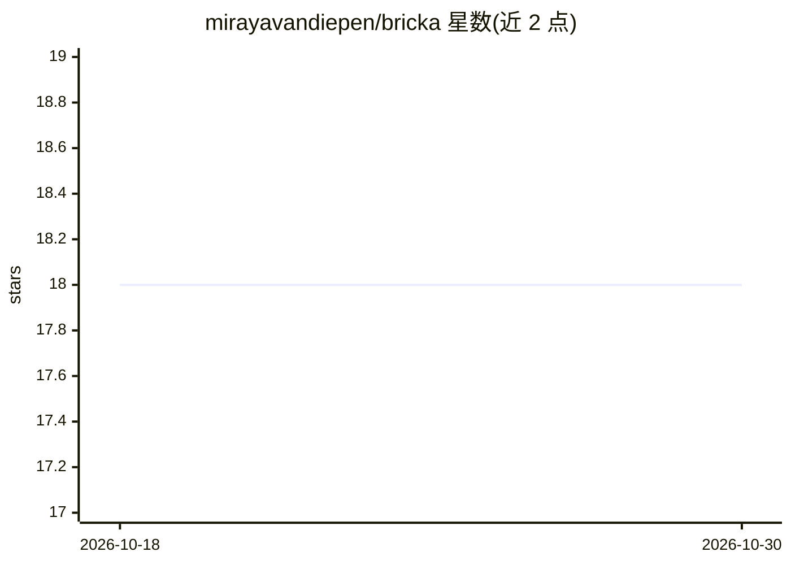

# mirayavandiepen/bricka

⭐ 18 · TypeScript · MIT · 推送 2026-10-12 · [GitHub](https://github.com/mirayavandiepen/bricka) · [官网](https://bricka.mirayavandiepen.com) · 个人维护

**React AI 应用输入框组件：文件、人、命令以 token 形式内嵌消息**

面向 React 18+ 的可组合 composer 组件，把 @提及、/命令、文件附件等变成带 id 与类型的结构化 token，发送时同时给出纯文本与被引用对象。内置触发器、静态列表或 API 的模糊搜索（含防抖与取消）、可接任意模型的 ghost-text 自动补全（支持流式）、附件粘贴/拖拽、键盘与屏幕阅读器无障碍支持及 CSS 变量主题。无其他运行时依赖，npm 安装，各部分组件可拆分使用，附 useComposer 等 hooks 与序列化辅助函数。

## 筛选速览

| 维度 | 判定 | 备注 |
|---|---|---|
| AI 角色 | `ai-ecosystem` | LLM/agent 周边工具 |
| 许可风险 | `permissive` | MIT |
| 部署形态 | `library` | 以包/库形式分发 |
| 模型依赖 | — | README 未给出锁定关系 |
| 硬件要求 | — | 无带数字的原话,不猜 |
| 安装摩擦 | `low` | 无编译、无系统依赖或容器化 |
| 成熟度 | — | 结构信号不足 |

## 能力要点

- @提及、/命令等转为结构化 token，发送时无需再解析
- ghost-text 自动补全可接任意模型并支持流式输出
- 粘贴/拖拽/选择器三种附件方式，自带预览
- 全键盘操作、屏幕阅读器播报与 IME 安全输入

## 适用场景

- AI 聊天应用中让用户在消息里引用文件、人员或工具
- 为应用构建带 @提及与 /命令的输入框
- 接入自定义模型实现输入时的行内自动补全

## 场景标签

 · 领域:前端组件/开发工具

## 证据(README 行号)

> L3:  A React composer where files, people, tools and commands live inside the message as real tokens.
> L22: - **Ghost-text autocomplete** from any model, including streaming.

## 星数曲线

2026-10-18 18 → 2026-10-30 18（+0）

---
*卡片 v1 · prompt 1.4 · 生成 2026-10-29 · 置信度 high · 依据 README sha `461b2c6bc337` · [字段定义](../../DATASET.md)*
