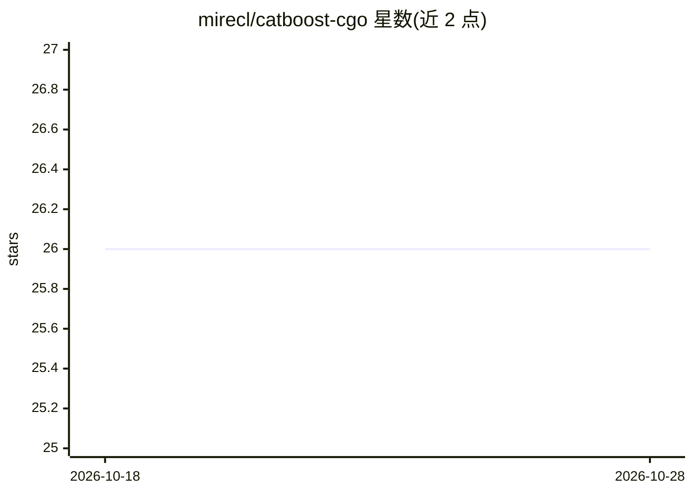

# mirecl/catboost-cgo

⭐ 26 · C · MIT · 推送 2026-08-20 · [GitHub](https://github.com/mirecl/catboost-cgo) · 个人维护

**Go 通过 Cgo 调用 CatBoost 模型做快速推理的绑定库**

面向 Golang 开发者的 CatBoost 模型推理绑定库：通过 Cgo 调用 CatBoost 官方 C API 共享库（*.so/*.dylib），支持 Regressor/Classifier/Ranker 及多种预测类型（RawFormulaVal/Probability/Class/Exponent 等），特征支持数值、类别与文本，Embeddings 暂不支持。平台限制：macOS/Linux x86_64 可用，Linux 支持 CUDA（仅 device 0），Windows 不支持。安装需 go get 并另行下载 CatBoost 共享库。

## 筛选速览

| 维度 | 判定 | 备注 |
|---|---|---|
| AI 角色 | `ai-native` | 本体是模型或模型工具 |
| 许可风险 | `permissive` | MIT |
| 部署形态 | `desktop` | 安装包/桌面程序 |
| 模型依赖 | — | README 未给出锁定关系 |
| 硬件要求 | — | 无带数字的原话,不猜 |
| 安装摩擦 | `medium` | 含编译或系统依赖之一 |
| 成熟度 | — | 结构信号不足 |

## 能力要点

- Cgo 调用 CatBoost C API 共享库进行推理
- 支持 Regressor/Classifier/Ranker 与多种预测类型
- 支持数值/类别/文本特征（Embeddings 不支持）
- 兼容 CatBoost v1.2.2–v1.2.8 多个版本

## 适用场景

- 在 Go 服务中加载并推理已训练的 CatBoost 模型
- 将 CatBoost 回归/分类/排序模型接入 Golang 生产环境
- 查看模型 Metadata 与不确定性预测

## 场景标签

 · 领域:机器学习推理/Go 库

## 证据(README 行号)

> L7: Evaluation library is the fastest way for inference a model CatBoost. The library provides a C API.\
> L43: + CatBoostRegressor ✅

## 星数曲线

2026-10-18 26 → 2026-10-28 26（+0）

---
*卡片 v1 · prompt 1.4 · 生成 2026-10-27 · 置信度 high · 依据 README sha `fb9fc46adfc7` · [字段定义](../../DATASET.md)*
