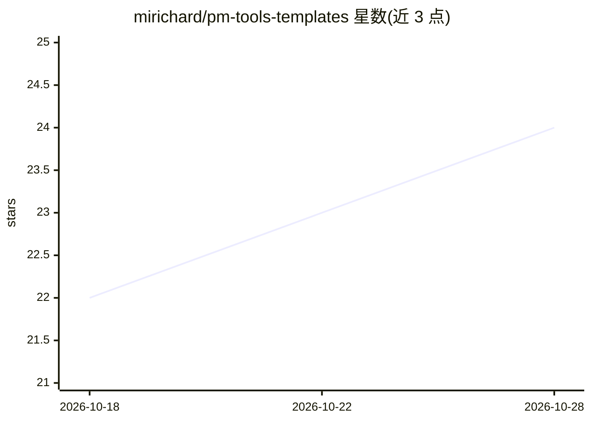

# mirichard/pm-tools-templates

⭐ 24 · HTML · NOASSERTION · 推送 2026-10-28 · [GitHub](https://github.com/mirichard/pm-tools-templates) · [官网](https://mirichard.github.io/pm-tools-templates) · 个人维护

**项目经理可用的开源模板与指南库（139 个模板，六大领域）**

面向采用传统、敏捷或混合方法的项目与项目群经理，收录 139 个模板、示例与指南，按干系人、团队、交付、规划、不确定性与度量六个领域组织，另提供快速入门套件、按角色分组工具包、行业合集与方法论选择指南。使用方式为浏览/下载文件后按项目改写，无需安装仓库；获取全集可下载 ZIP。另含三个可选 CLI/演示工具；AI insights 功能已因可靠性问题撤下（L51）。由个人（Michael Richard, PMP）以 MIT 许可维护。

## 筛选速览

| 维度 | 判定 | 备注 |
|---|---|---|
| AI 角色 | `ai-knowledge` | 知识聚合/清单类 |
| 许可风险 | `none` | NOASSERTION |
| 部署形态 | `None` |  |
| 模型依赖 | — | README 未给出锁定关系 |
| 硬件要求 | — | 无带数字的原话,不猜 |
| 安装摩擦 | `low` | 无编译、无系统依赖或容器化 |
| 成熟度 | — | 结构信号不足 |

## 能力要点

- 139 个模板覆盖六大工作领域，支持传统/敏捷/混合方法
- 提供新手入门套件、模板选择指南与角色工具包
- 模板浏览器支持搜索、筛选、预览与下载
- 附带模板生成 CLI、需求结构化 CLI 与项目健康仪表盘演示（可选）

## 适用场景

- 第一次管项目时用入门套件和简化模板起步
- 按职责或项目场景挑选干系人分析、风险、进度类模板
- 参考示例与案例学习模板的实际填写方式

## 场景标签

`精选清单` · 领域:学习与行业

## 证据(README 行号)

> L3: Templates, examples, and guides for project and program managers working with traditional, Agile, and hybrid approac
> L51: - AI insights is withdrawn pending reliability work; see the development preservation record.

## 星数曲线

2026-10-18 22 → 2026-10-28 24（+2）

---
*卡片 v1 · prompt 1.4 · 生成 2026-10-27 · 置信度 low · 依据 README sha `e15b5ed3971c` · [字段定义](../../DATASET.md)*
