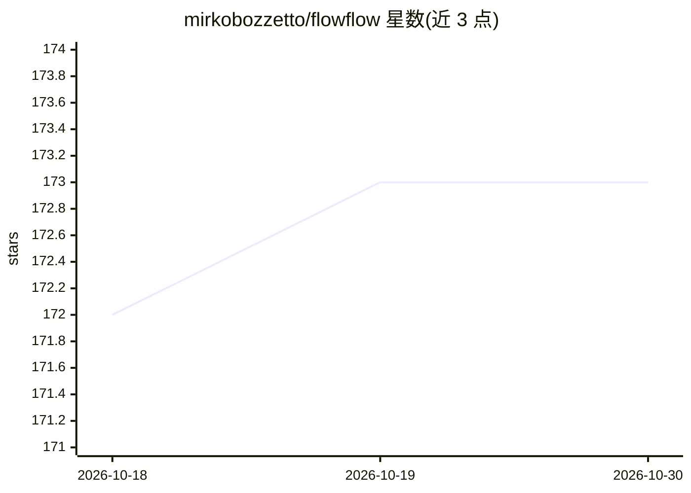

# mirkobozzetto/flowflow

⭐ 173 · Rust · EUPL-1.2 · 推送 2026-10-18 · [GitHub](https://github.com/mirkobozzetto/flowflow) · [官网](https://apps.apple.com/us/app/flowflow/id6773033233) · 个人维护

**iPhone/Mac 语音笔记应用：录音转写、与笔记 RAG 对话与执行动作**

面向 iPhone 与 Mac（Apple Silicon）的个人语音笔记应用，主体为 Rust + Dioxus。录音后经云端 Soniox 或本地 Whisper 转写，自动生成 AI 标题、标签与主题；支持 RAG 对话（BM25+向量+重排混合检索），回答可选 Claude/OpenAI/ChatGPT 订阅或私有 Hermes Agent，嵌入使用 OpenAI API，可选 Exa 网络搜索。笔记可转为日历事件等动作，连接器经 MCP 接入。设备间采用 Noise 协议加密局域网 P2P 同步，无服务器。iOS 经 App Store 分发，macOS 提供签名 DMG，亦可从源码构建；Linux/Windows 不支持。

## 筛选速览

| 维度 | 判定 | 备注 |
|---|---|---|
| AI 角色 | `ai-native` | 本体是模型或模型工具 |
| 许可风险 | `viral` | EUPL-1.2 |
| 部署形态 | `library` | 以包/库形式分发 |
| 模型依赖 | locked-api |  |
| 硬件要求 | — | 无带数字的原话,不猜 |
| 安装摩擦 | `low` | 无编译、无系统依赖或容器化 |
| 成熟度 | — | 结构信号不足 |

## 能力要点

- 云端 Soniox 或本地 Whisper 离线转写（长录音分块、断点续传）
- RAG 对话带可点按来源，混合检索 BM25+向量+重排
- AI 标题/标签/主题自动生成，会议纪要含要点与定时行动项
- 加密 LAN P2P 同步（Noise 协议），无服务器无云端
- 接入私有 Hermes Agent（Tailscale + MCP），空间可授权读写

## 适用场景

- 散步或间隙时口述想法，稍后用对话检索原文段落
- 录音长会议并自动分章、摘要要点与行动项
- 让笔记中的提醒转成日历事件等实际动作

## 场景标签

`知识库管理` `语音识别` `文档问答` · 领域:知识与检索

## 证据(README 行号)

> L10: FlowFlow is a voice notes app that captures what you say, transcribes it, and lets you **chat with your notes** lat
> L52: - RAG chat with tappable sources: hybrid search (BM25 + vector + rerank)
> L126: Talk   → Record → Transcribe (cloud or on-device) → Clean fillers → Apply dictionary → Auto-embed → Store → AI tit

## 星数曲线

2026-10-18 172 → 2026-10-30 173（+1）

---
*卡片 v1 · prompt 1.4 · 生成 2026-10-22 · 置信度 high · 依据 README sha `45ee64222df8` · [字段定义](../../DATASET.md)*
