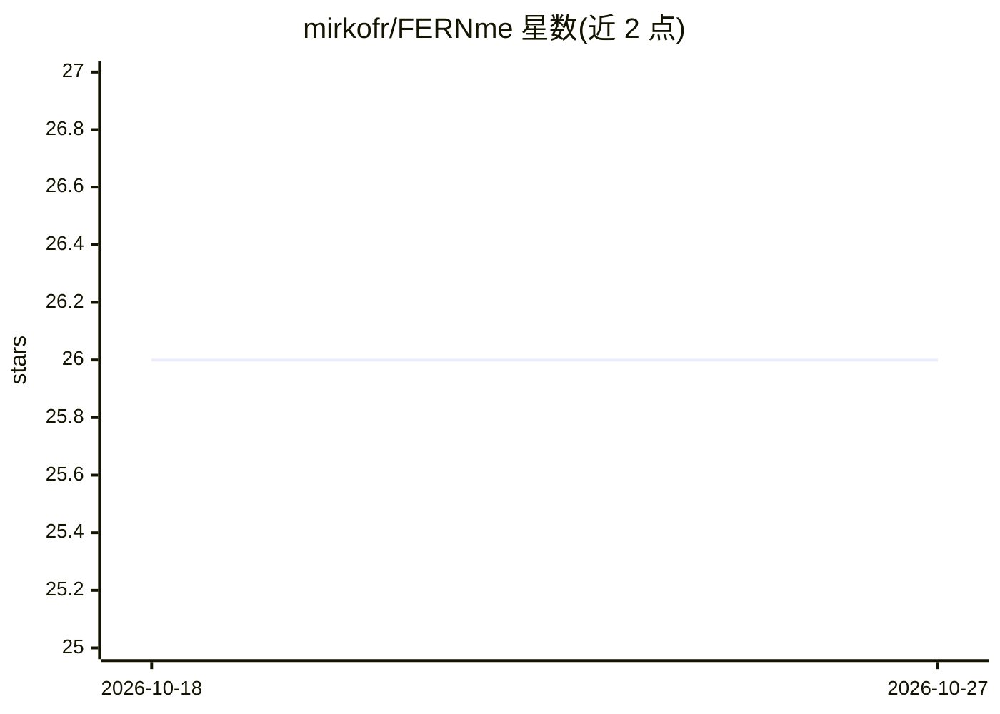

# mirkofr/FERNme

⭐ 26 · Python · NOASSERTION · 推送 2026-10-01 · [GitHub](https://github.com/mirkofr/FERNme) · [官网](https://www.fernme.dev) · 个人维护

**面向 AI agent 的用户个性化记忆引擎，零 LLM 调用写入**

为 AI agent 提供长期记忆层的 Python 库：以模糊加权图建模用户偏好、习惯、风格与结果，写入用图算术实现零 LLM 调用，检索采用扩散激活，提示卡只存偏离群体先验的偏差以保持体积恒定。支持每用户可见、可编辑、可删除与许可门控、按站点隔离。提供 MCP 服务器与插件，可从 Claude Code、Codex 等 MCP 客户端使用。基准均基于合成或 LLM 生成数据，README 自述部分场景简单基线表现更优，真人实验尚未进行。需 Python 3.10+。

## 筛选速览

| 维度 | 判定 | 备注 |
|---|---|---|
| AI 角色 | `ai-ecosystem` | LLM/agent 周边工具 |
| 许可风险 | `permissive` | NOASSERTION |
| 部署形态 | `library` | 以包/库形式分发 |
| 模型依赖 | — | README 未给出锁定关系 |
| 硬件要求 | — | 无带数字的原话,不猜 |
| 安装摩擦 | `low` | 无编译、无系统依赖或容器化 |
| 成熟度 | `idea` | |

## 能力要点

- 记忆写入零 LLM 调用，为确定性图算术
- 提示卡约 25-40 token，体积随记忆增长保持平坦
- 用户级记忆可见/可编辑/可删除，许可门控、按站点隔离
- 提供 MCP 服务器（fernme-mcp）与可捆绑插件

## 适用场景

- 为多用户服务型 agent 提供个性化记忆而不膨胀提示
- 在 Claude Code、Codex 等 MCP 客户端中接入长期记忆
- 需要用户可审查、可删除记忆数据的合规场景

## 场景标签

`Agent 记忆` · 领域:Agent 开发

## 证据(README 行号)

> L49: Most agent memory is **written by an LLM on every turn** (expensive, hallucination-prone), **evaluated on question-
> L53: |A user-owned personalization memory layer for agents|A generic transcript store|
> L43: Use it from Claude Code, Codex, or any MCP client: run `fernme-mcp`, or add the

## 星数曲线

2026-10-18 26 → 2026-10-27 26（+0）

---
*卡片 v1 · prompt 1.4 · 生成 2026-10-26 · 置信度 high · 依据 README sha `d5472378658e` · [字段定义](../../DATASET.md)*
