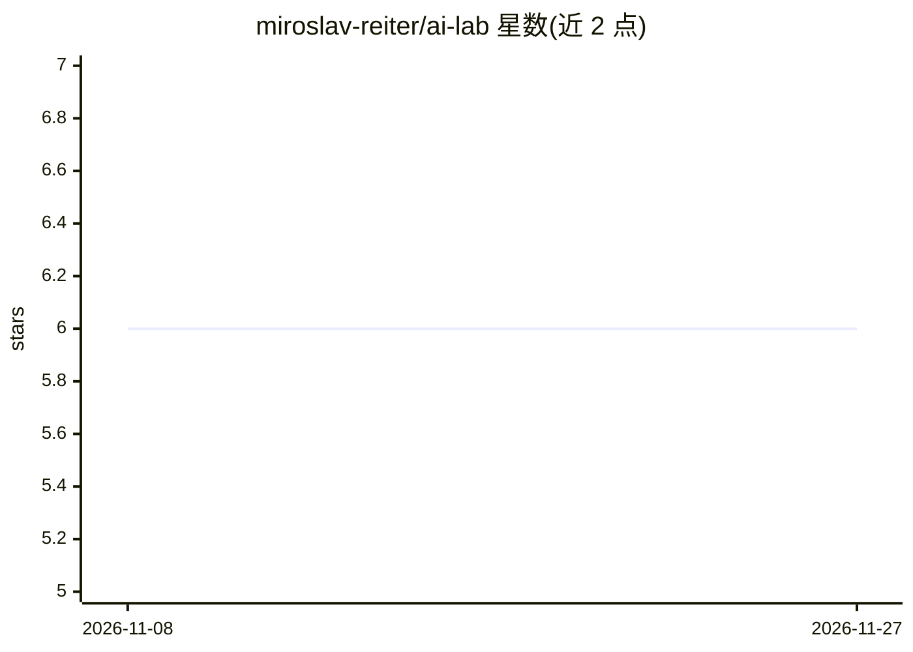

# miroslav-reiter/ai-lab

⭐ 6 · Python · 推送 2026-11-03 · [GitHub](https://github.com/miroslav-reiter/ai-lab) · [官网](https://www.vita.sk/) · 个人维护

**面向教师与研究者的 GPTZero AI 文本检测培训教程仓库**

斯洛伐克语的在线课程配套教学仓库，围绕 GPTZero 的实践使用组织：提供 16 个实操示例、5 个实验任务、10 个 AI 生成的测试文本样本（含斯洛伐克语与英语）、cheat sheet、方法论与伦理说明。核心机制是准备已知来源的受控样本，将 GPTZero 分类结果记录到 CSV 后用自带的离线 Python 脚本统计吻合率与误报/漏报，脚本无需外部库且不联网。面向教师、博士生、法证分析师、SEO 与营销人员等。

## 筛选速览

| 维度 | 判定 | 备注 |
|---|---|---|
| AI 角色 | `ai-knowledge` | 知识聚合/清单类 |
| 许可风险 | `none` | — |
| 部署形态 | `None` |  |
| 模型依赖 | — | README 未给出锁定关系 |
| 硬件要求 | — | 无带数字的原话,不猜 |
| 安装摩擦 | `low` | 无编译、无系统依赖或容器化 |
| 成熟度 | — | 结构信号不足 |

## 能力要点

- 10 个 AI 生成测试文本样本与人工对照样本的制作方法
- 离线 Python 脚本计算分类吻合率与 false positives/negatives
- 16 个实操示例 + 5 个实验任务 + cheat sheet
- 学术诚信与数据保护的伦理准则章节

## 适用场景

- 培训学生如何理解 GPTZero 的 Human/AI/Mixed 分类结果
- 为学校或机构设计 AI 文本检测的实验课
- 检查博客、营销文案或社交平台内容的 AI 生成特征并核查引文

## 场景标签

`教程课程` · 领域:学习与行业

## 证据(README 行号)

> L5: Tento repozitár slúži na **praktické školenie GPTZero a detekcie AI generovaného textu**, prácu s AI vo výučbe, mark
> L92: |scripts/vyhodnotenie-gptzero.py|**offline** výpočet výsledkov klasifikácie bez GPTZero API|

## 星数曲线

2026-11-08 6 → 2026-11-27 6（+0）

---
*卡片 v1 · prompt 1.4 · 生成 2026-11-20 · 置信度 high · 依据 README sha `200b602d7456` · [字段定义](../../DATASET.md)*
