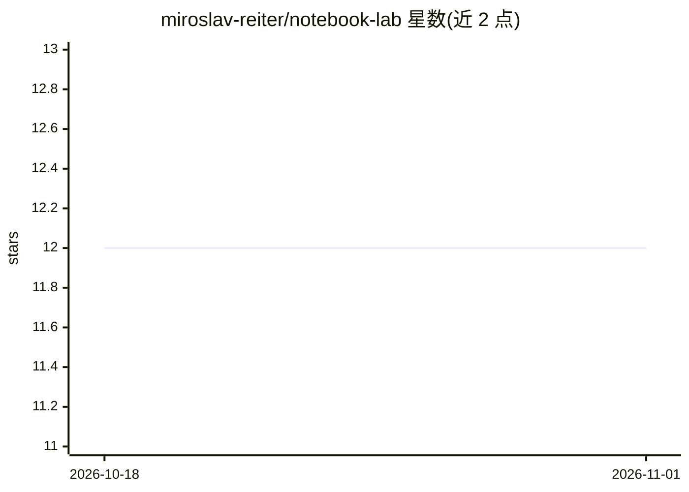

# miroslav-reiter/notebook-lab

⭐ 12 · 推送 2026-10-13 · [GitHub](https://github.com/miroslav-reiter/notebook-lab) · [官网](https://www.vita.sk/) · 个人维护

**Google NotebookLM 中级实操课程仓库（4 个实验室）**

面向已掌握基础操作的 NotebookLM 用户的在线课程配套仓库：包含 4 个实验室（LAB A-D），分别练习多来源专家指南对比、咨询对话录音转写分析、两版内部指令对比、官方文档综合。提供可复用的提示词模板（来源 + 任务 + 规则 + 输出格式 + 检查）、讲师脚本、学员工作簿、参考答案与评分标准。强调引用核查、区分事实与解读，并给出数据安全规则与官方文档链接列表。

## 筛选速览

| 维度 | 判定 | 备注 |
|---|---|---|
| AI 角色 | `ai-knowledge` | 知识聚合/清单类 |
| 许可风险 | `none` | — |
| 部署形态 | `None` |  |
| 模型依赖 | — | README 未给出锁定关系 |
| 硬件要求 | — | 无带数字的原话,不猜 |
| 安装摩擦 | `low` | 无编译、无系统依赖或容器化 |
| 成熟度 | — | 结构信号不足 |

## 能力要点

- 4 个实验室：来源对比、对话分析、版本差异、文档综合
- 可复用的提示词模板（来源+任务+规则+输出格式+检查）
- 讲师脚本、学员工作簿、参考答案与评分标准材料
- 引用审计与事实/解读/计算/建议的分类方法

## 适用场景

- 学习如何对比多个来源并产出可核查的 NotebookLM 输出
- 分析对话录音转写并生成需求、异议和辅导计划
- 对比文档的旧版本和新版本以区分已批准与已拒绝的修改
- 从官方文档中综合出操作指南

## 场景标签

`教程课程` `提示工程` · 领域:Agent 开发

## 证据(README 行号)

> L3: Praktický repozitár pre online kurz **Google Gemini Notebook (NotebookLM) Praktické cvičenia** na mierne pokročilej 
> L115: Kurz pozostáva zo štyroch samostatných laboratórií.

## 星数曲线

2026-10-18 12 → 2026-11-01 12（+0）

---
*卡片 v1 · prompt 1.4 · 生成 2026-11-01 · 置信度 high · 依据 README sha `2fe58bfe19ed` · [字段定义](../../DATASET.md)*
