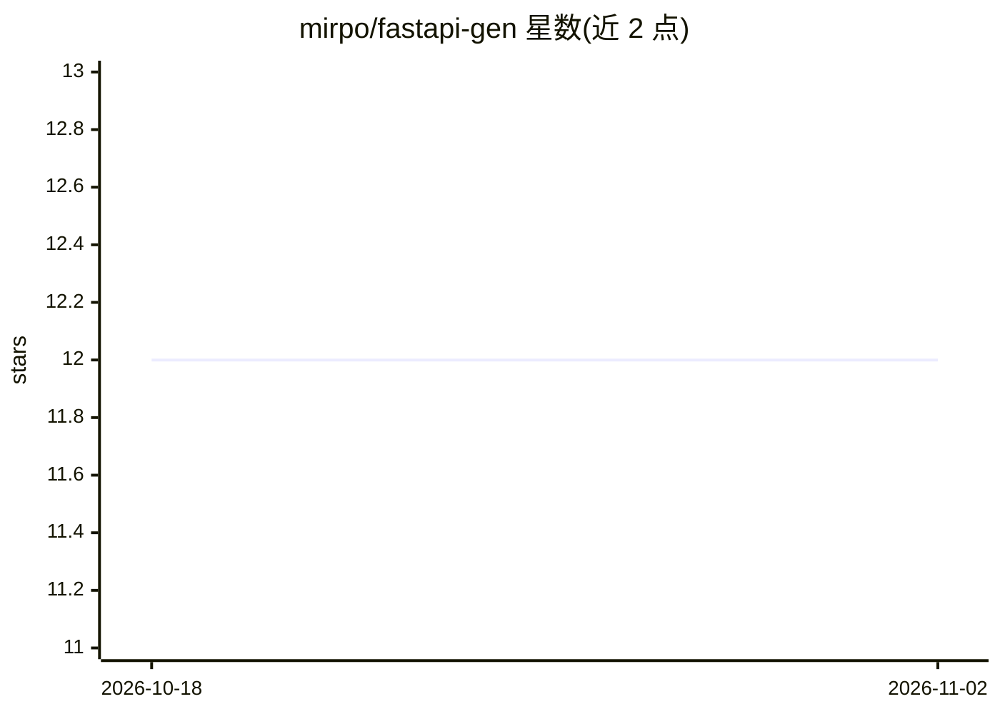

# mirpo/fastapi-gen

⭐ 12 · Python · MIT · 推送 2026-10-30 · [GitHub](https://github.com/mirpo/fastapi-gen) · [官网](https://pypi.org/project/fastapi-gen) · 个人维护

**FastAPI 项目脚手架 CLI：一条命令生成含 LLM 能力的应用模板**

Python 命令行工具，通过 uvx/pip 安装后以 fastapi-gen my_app 生成 FastAPI 项目，无需构建配置。提供 5 种模板：hello_world（基础 CRUD）、advanced（JWT 认证、SQLAlchemy 数据库）、nlp（摘要/NER/生成等 8 种能力）、langchain（LLM 工作流）、llama（基于 llama-cpp-python 的本地 GGUF 模型推理，需约 4GB 模型下载与 4GB+ 内存）。生成项目内置依赖预配置、测试、Ruff 与 OpenAPI 文档，以 make start 运行。要求 Python 3.11+，支持 macOS 与 Linux。

## 筛选速览

| 维度 | 判定 | 备注 |
|---|---|---|
| AI 角色 | `ai-ecosystem` | LLM/agent 周边工具 |
| 许可风险 | `permissive` | MIT |
| 部署形态 | `library` | 以包/库形式分发 |
| 模型依赖 | local-ok | 支持本地模型 |
| 硬件要求 | — | 无带数字的原话,不猜 |
| 安装摩擦 | `low` | 无编译、无系统依赖或容器化 |
| 成熟度 | — | 结构信号不足 |

## 能力要点

- 5 种模板覆盖基础 API 到本地 LLM 推理
- Llama 模板支持 Gemma/Llama GGUF 模型与 GPU 自动检测
- 零配置生成：依赖预配置、测试、lint、OpenAPI 文档齐备
- 支持 uvx 免安装直接运行

## 适用场景

- 快速起一个生产结构的 FastAPI 项目跳过样板配置
- 生成带 LangChain 或本地 Llama 模型的 LLM 应用骨架
- 获得带 JWT 认证和数据库的企业级 API 模板

## 场景标签

`代码生成` · 领域:编码与开发

## 证据(README 行号)

> L103: **Best for:** Applications using LangChain for LLM workflows
> L93: - 8 NLP capabilities: summarization, NER, generation, QA, embeddings, sentiment, classification, similarity

## 星数曲线

2026-10-18 12 → 2026-11-02 12（+0）

---
*卡片 v1 · prompt 1.4 · 生成 2026-11-01 · 置信度 high · 依据 README sha `2b0111a9bdfa` · [字段定义](../../DATASET.md)*
