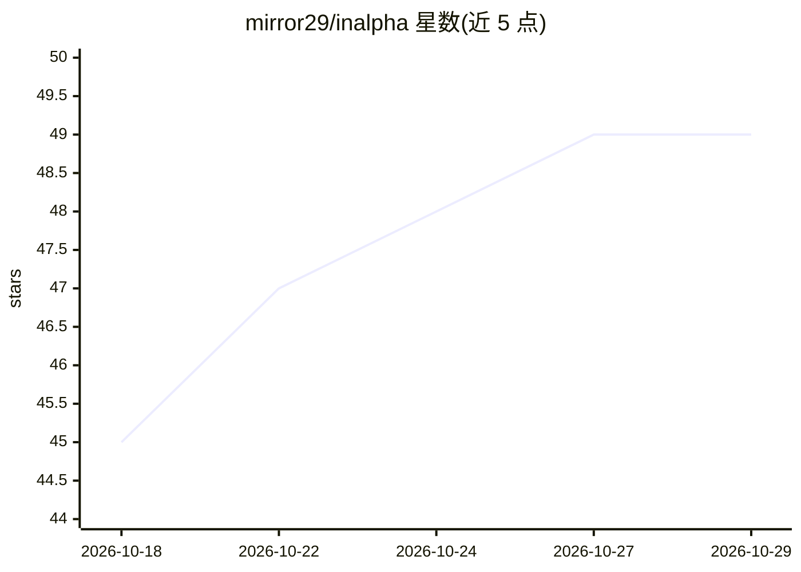

# mirror29/inalpha

⭐ 49 · Python · AGPL-3.0 · 推送 2026-10-28 · [GitHub](https://github.com/mirror29/inalpha) · [官网](https://inalpha.dev/) · 个人维护 · 中文 README

**开源量化 agent 框架：LLM 研究选因子写策略，机器审批下单**

面向量化团队的专业 agent 框架：LLM agent 在钩子、权限、计划-执行审批与一次性订单签名的工程护栏内工作——按时间序列 Rank IC 挑选当前有效因子择时、编写并进化完整 Python 策略代码、经统一 diff 变异与多目标适应度评估；LLM 不在下单路径，订单须走 create_plan→approve→execute 且使用 TTL 一次性令牌。含操作台（Next.js）、Mastra 编排层与五个 FastAPI 服务，覆盖加密、美股、A 股等多市场纸面交易。声明处于 alpha，真实资金交易不在范围内。

## 筛选速览

| 维度 | 判定 | 备注 |
|---|---|---|
| AI 角色 | `ai-native` | 本体是模型或模型工具 |
| 许可风险 | `viral` | AGPL-3.0 |
| 部署形态 | `self-host` | docker 或自建部署 |
| 模型依赖 | local-ok | 支持本地模型 |
| 硬件要求 | — | 无带数字的原话,不猜 |
| 安装摩擦 | `low` | 无编译、无系统依赖或容器化 |
| 成熟度 | `idea` | |

## 能力要点

- 因子按时间序列 Rank IC 排序做择时，含经济学故事闸门与五类偏差防护
- 策略进化走统一 diff 变异 + AST 审计 + 沙箱子进程执行，不自动晋升
- 订单路径 LLM 不可直达：一次性 TTL approval_token + 审计日志
- 统一内核：回测与纸面交易共用同一策略代码，仅换 Clock/Gateway

## 适用场景

- 用量化 agent 做因子研究、验证与择时
- 在沙盒中进化并回测 LLM 编写的完整策略
- 多市场纸面交易运行已晋升策略并逐条审计决策
- 在带护栏的操作台里监控组合、风险锁与运行器

## 场景标签

`Agent 框架` `金融量化` · 领域:Agent 开发

## 证据(README 行号)

> L21:  Inalpha is a professional quant agent framework — an open-source system where LLM agents research (with a panel of
> L37: - **Machine-approved orders (no direct LLM path)** — order intents go `trade.create_plan → approve → execute_plan` 

## 星数曲线

2026-10-18 45 → 2026-10-29 49（+4）

---
*卡片 v1 · prompt 1.4 · 生成 2026-10-25 · 置信度 mid · 依据 README sha `043ead80021c` · [字段定义](../../DATASET.md)*
