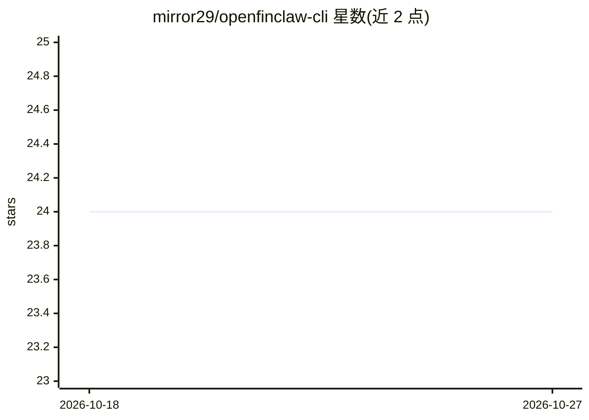

# mirror29/openfinclaw-cli

⭐ 24 · TypeScript · 推送 2026-05-27 · [GitHub](https://github.com/mirror29/openfinclaw-cli) · [官网](https://hub.openfinclaw.ai/) · 个人维护 · 中文 README

**量化研究 AI agent 的 MCP 工具集：一句话完成研究·策略·回测·模拟**

面向量化交易的 MCP server + 终端 CLI（npm 包），把 DeepAgent（60+ 金融分析技能，覆盖美股/A股/港/加密/外汇）与本地策略工具组接入 Claude Code、Cursor 等 20+ MCP 兼容 agent 平台。用户以自然语言 prompt 触发研究→策略→回测→发布流水线，另含社区策略榜、fork 与发布功能。需要 fch_ API key（云端 Hub Gateway），策略组含 7 个本地 FEP 工具。安装向导自动写 MCP 配置并注册 SKILL.md。

## 筛选速览

| 维度 | 判定 | 备注 |
|---|---|---|
| AI 角色 | `ai-ecosystem` | LLM/agent 周边工具 |
| 许可风险 | `permissive` | — |
| 部署形态 | `library` | 以包/库形式分发 |
| 模型依赖 | — | README 未给出锁定关系 |
| 硬件要求 | — | 无带数字的原话,不猜 |
| 安装摩擦 | `low` | 无编译、无系统依赖或容器化 |
| 成熟度 | — | 结构信号不足 |

## 能力要点

- 60+ DeepAgent 分析技能（技术面/基本面/情绪/风险/择时/因子）
- 覆盖 5 类市场：美股、A股、港股、加密货币、外汇
- 接入 20+ MCP 兼容平台，install 向导自动写入配置并注册 SKILL.md
- 社区策略榜：浏览、fork、发布，服务端回测统一排名

## 适用场景

- 在 Claude Code 或 Cursor 里用一句话跑完量化研究、策略生成与回测
- 浏览社区策略榜并 fork 高排名策略到本地修改
- 通过 MCP 原子工具（research_submit/poll/finalize）在脚本或 agent 中编排量化任务

## 场景标签

`金融量化` · 领域:学习与行业

## 证据(README 行号)

> L7: Research · strategy · backtest · paper trade — ship a complete quant workflow from a single natural-language prompt,
> L112: OpenFinClaw works with any MCP-compatible agent platform:
> L151: |`deepagent`|14 remote-agent tools — `fin_deepagent_health` / `_skills` / `_research_submit` / `_research_poll` / 

## 星数曲线

2026-10-18 24 → 2026-10-27 24（+0）

---
*卡片 v1 · prompt 1.4 · 生成 2026-10-27 · 置信度 high · 依据 README sha `ba336df9495b` · [字段定义](../../DATASET.md)*
