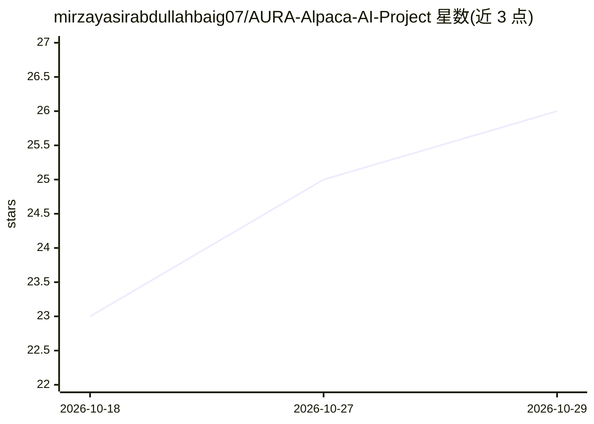

# mirzayasirabdullahbaig07/AURA-Alpaca-AI-Project

⭐ 26 · Python · 推送 2026-08-24 · [GitHub](https://github.com/mirzayasirabdullahbaig07/AURA-Alpaca-AI-Project) · [官网](https://aura-alpaca-ai-project.streamlit.app/) · 个人维护

**可审计的自主交易 agent：AI 提议、确定性风险引擎否决**

面向量化交易研究者的多 agent 原型（黑客松项目）：Market/Strategy/Critic 三个 LLM agent（Groq 上的 openai/gpt-oss-20b，结构化 JSON 输出）分析技术指标并生成交易论点，随后由非 LLM 的确定性风险引擎强制执行敞口、仓位、风险回报与置信度硬限制，AI 无法越过。每条决策（含被拒绝的）生成可回放的执行日志。仅支持 Alpaca paper trading——配置层面拒绝实盘账户启动。提供 Streamlit 仪表盘与 SQLite 持久化，Python 3.10+，pip 依赖安装。

## 筛选速览

| 维度 | 判定 | 备注 |
|---|---|---|
| AI 角色 | `ai-native` | 本体是模型或模型工具 |
| 许可风险 | `none` | — |
| 部署形态 | `library` | 以包/库形式分发 |
| 模型依赖 | locked-api |  |
| 硬件要求 | — | 无带数字的原话,不猜 |
| 安装摩擦 | `low` | 无编译、无系统依赖或容器化 |
| 成熟度 | `idea` | |

## 能力要点

- 四阶段决策管线：Market→Strategy→对抗性 Critic→确定性 Risk Engine
- 风险引擎为非 LLM 代码，AI 无法覆盖安全规则
- 拒绝实盘：ALPACA_PAPER 非 true 时拒绝启动
- 全部决策（执行或拒绝）记录为可回放执行日志

## 适用场景

- 在 Alpaca paper 账户上跑自主交易实验周期
- 研究带硬性风险限制的多 agent 决策治理架构
- 查看带完整理由链的交易/拒绝决策日志

## 场景标签

`金融量化` `多智能体` · 领域:Agent 开发

## 证据(README 行号)

> L21: AURA is an autonomous trading agent built on a single principle:
> L33:    │  REASONING LAYER  (probabilistic · LLM-powered)           │
> L61: - **LLM inference:** Groq (`openai/gpt-oss-20b`), structured JSON output

## 星数曲线

2026-10-18 23 → 2026-10-29 26（+3）

---
*卡片 v1 · prompt 1.4 · 生成 2026-10-27 · 置信度 mid · 依据 README sha `0ea157fc3071` · [字段定义](../../DATASET.md)*
