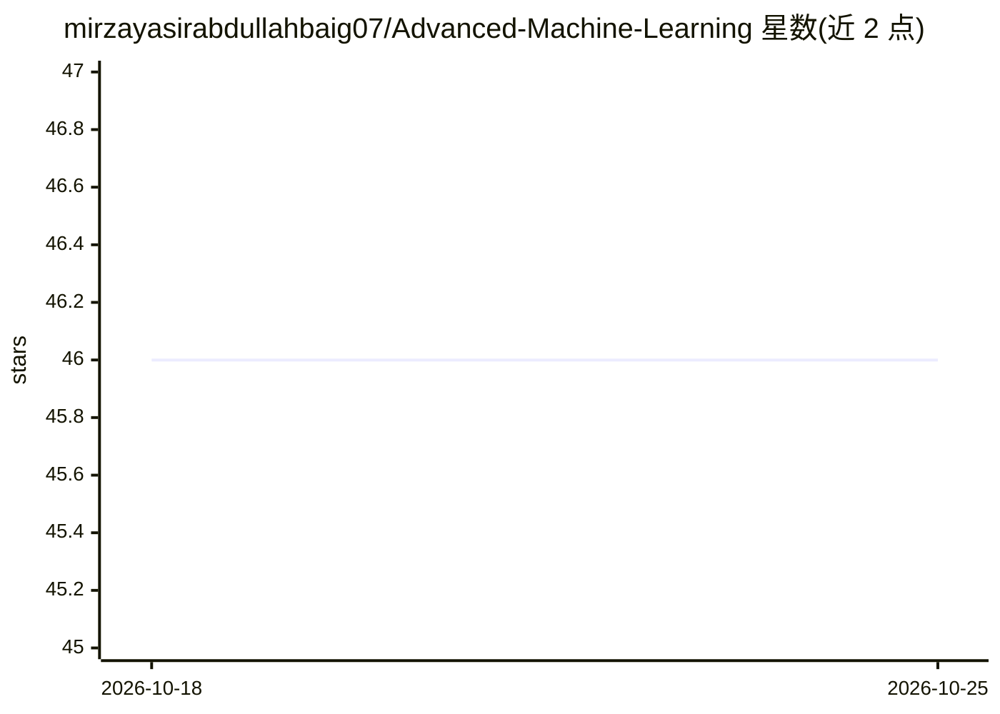

# mirzayasirabdullahbaig07/Advanced-Machine-Learning

⭐ 46 · Python · 推送 2026-01-12 · [GitHub](https://github.com/mirzayasirabdullahbaig07/Advanced-Machine-Learning) · 个人维护

**机器学习学习路径仓库：从基础到进阶的笔记与代码实现**

个人学习仓库，提供结构化机器学习课程内容：涵盖 ML 概念、数据获取与 EDA、特征工程、缺失值与异常值处理、降维（PCA）、回归与分类模型、决策树与集成方法、聚类及 XGBoost/超参数调优等高级主题，共 14 个章节。每个主题包含笔记、代码示例与练习，按顺序阅读即可完成学习。内容包括直觉解释、数学推导与 Python 实现。

## 筛选速览

| 维度 | 判定 | 备注 |
|---|---|---|
| AI 角色 | `ai-knowledge` | 知识聚合/清单类 |
| 许可风险 | `none` | — |
| 部署形态 | `None` |  |
| 模型依赖 | — | README 未给出锁定关系 |
| 硬件要求 | — | 无带数字的原话,不猜 |
| 安装摩擦 | `low` | 无编译、无系统依赖或容器化 |
| 成熟度 | — | 结构信号不足 |

## 能力要点

- 14 章结构化课程覆盖数据处理、特征工程、回归/分类、集成与聚类
- 每个主题包含笔记、代码示例与练习
- 包含从零实现（梯度下降、K-Means）与数学推导

## 适用场景

- 系统自学机器学习从基础到进阶内容
- 查找特定 ML 主题的笔记与配套代码示例
- 按章节顺序跟做端到端 ML 项目练习

## 场景标签

`教程课程` · 领域:学习与行业

## 证据(README 行号)

> L5: This repo is dedicated to my learning journey in Machine Learning, covering concepts from intermediate to advanced l
> L15: This repository contains a structured learning path for mastering **Machine Learning** step by step.

## 星数曲线

2026-10-18 46 → 2026-10-25 46（+0）

---
*卡片 v1 · prompt 1.4 · 生成 2026-10-25 · 置信度 high · 依据 README sha `7cf7939609e0` · [字段定义](../../DATASET.md)*
