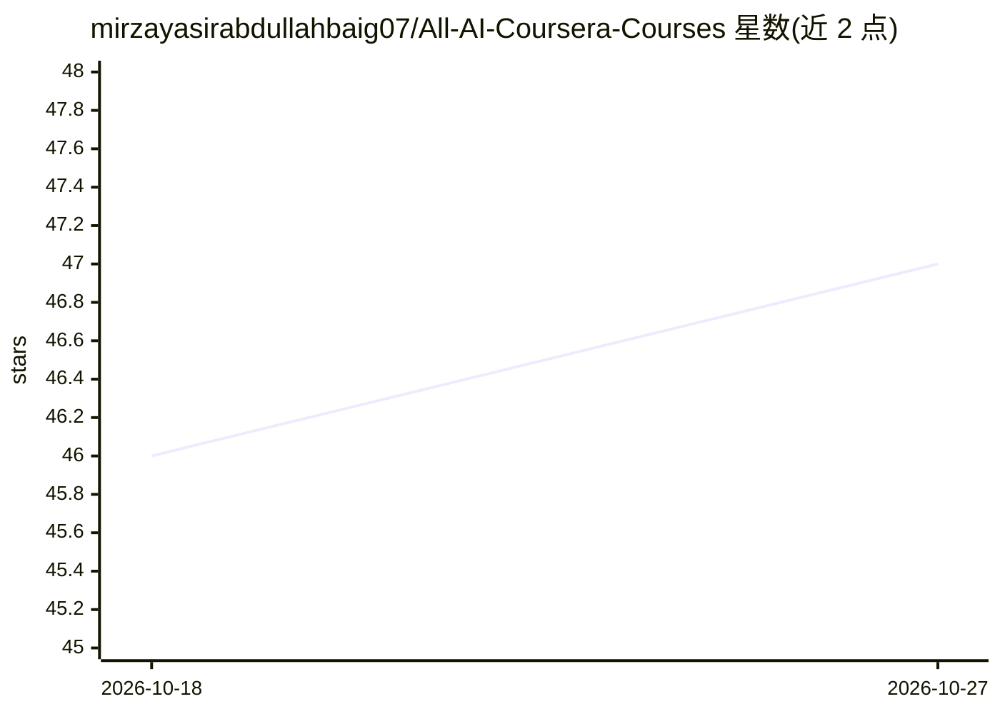

# mirzayasirabdullahbaig07/All-AI-Coursera-Courses

⭐ 47 · 推送 2026-05-07 · [GitHub](https://github.com/mirzayasirabdullahbaig07/All-AI-Coursera-Courses) · [官网](https://www.coursera.org/learner/mirza-yasir-abdullah-baig) · 个人维护

**个人 AI/数据科学一年学习与证书成果记录**

个人学习历程文档仓库：以清单形式记录作者一年内完成的 Coursera 课程与专项证书，涵盖 Google、IBM、DeepLearning.AI、Duke 大学等机构的数据分析、生成式 AI 工程、MLOps、机器学习、数学基础与数据结构算法等方向，并附每项课程的主题列表。仓库同时列出学习收获与后续目标，不包含可安装或可运行的软件，无代码实现。

## 筛选速览

| 维度 | 判定 | 备注 |
|---|---|---|
| AI 角色 | `ai-knowledge` | 知识聚合/清单类 |
| 许可风险 | `none` | — |
| 部署形态 | `None` |  |
| 模型依赖 | — | README 未给出锁定关系 |
| 硬件要求 | — | 无带数字的原话,不猜 |
| 安装摩擦 | `low` | 无编译、无系统依赖或容器化 |
| 成熟度 | — | 结构信号不足 |

## 能力要点

- 记录 7 项来自 Google/IBM/DeepLearning.AI/Duke/UCSD 的课程证书
- 按年份组织证书条目并附主题标签（MLOps、深度学习、微积分、算法等）
- 列出学习收获与后续目标（AI 研究、开源贡献、Kaggle）

## 适用场景

- 展示个人在 ML/MLOps/生成式 AI 方向的学习履历
- 参考他人选定的 AI 课程路径与顺序

## 场景标签

 · 领域:AI 教育/个人知识记录

## 证据(README 行号)

> L3: Over the past year, I’ve focused on building a strong foundation in **Machine Learning, Data Science, MLOps, and Gen
> L10: ## 🏆 Certifications

## 星数曲线

2026-10-18 46 → 2026-10-27 47（+1）

---
*卡片 v1 · prompt 1.4 · 生成 2026-10-25 · 置信度 mid · 依据 README sha `d44f5a894c8d` · [字段定义](../../DATASET.md)*
