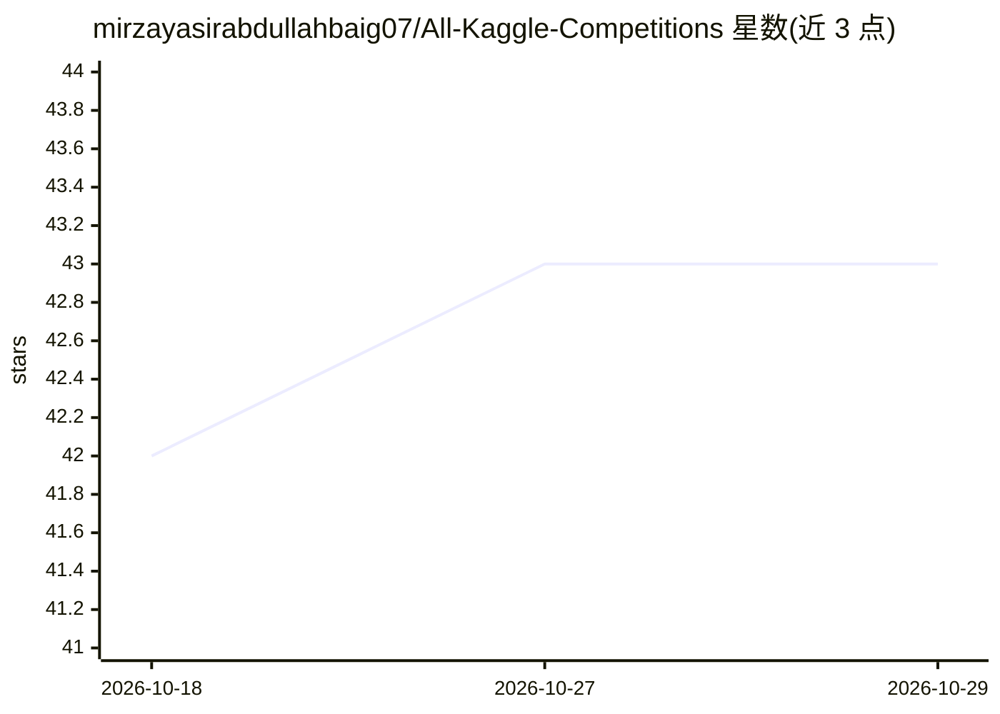

# mirzayasirabdullahbaig07/All-Kaggle-Competitions

⭐ 43 · 推送 2026-08-01 · [GitHub](https://github.com/mirzayasirabdullahbaig07/All-Kaggle-Competitions) · [官网](https://www.kaggle.com/myab07/competitions) · 个人维护

**个人 Kaggle 竞赛作品集：汇总参赛记录与排名**

个人 Kaggle 竞赛作品集仓库：以表格列出作者（myab07）参与的 22 项 Kaggle 竞赛的类别、排名与队伍数，覆盖 Playground、Featured、Community、Research、Code、Simulation 与 AI Agent 竞赛。另列出所展示的技能（特征工程、时间序列预测、计算机视觉、AutoML 等）与使用的工具库（NumPy、PyTorch、XGBoost 等），并附竞赛目标与联系方式链接。仓库本身为展示性文档，不含可安装运行的代码或数据。

## 筛选速览

| 维度 | 判定 | 备注 |
|---|---|---|
| AI 角色 | `ai-knowledge` | 知识聚合/清单类 |
| 许可风险 | `none` | — |
| 部署形态 | `None` |  |
| 模型依赖 | — | README 未给出锁定关系 |
| 硬件要求 | — | 无带数字的原话,不猜 |
| 安装摩擦 | `low` | 无编译、无系统依赖或容器化 |
| 成熟度 | — | 结构信号不足 |

## 能力要点

- 以表格记录 22 项 Kaggle 竞赛的类别、排名与参赛队伍数
- 列出机器学习技能清单（特征工程、模型评估、集成学习、AutoML 等）
- 列出常用工具库（PyTorch、TensorFlow、XGBoost、Optuna 等）

## 适用场景

- 查看作者的 Kaggle 参赛经历与排名表现
- 了解作者掌握的机器学习技能与工具栈
- 通过 Kaggle/LinkedIn/GitHub 链接联系作者

## 场景标签

 · 领域:机器学习竞赛/个人作品集

## 证据(README 行号)

> L3: Welcome to my Kaggle Competition Portfolio!
> L5: This repository showcases my participation, leaderboard rankings, and continuous learning journey across Kaggle comp
> L50: - 🏆 Currently participating in **22 Kaggle Competitions**

## 星数曲线

2026-10-18 42 → 2026-10-29 43（+1）

---
*卡片 v1 · prompt 1.4 · 生成 2026-10-25 · 置信度 high · 依据 README sha `fabdbb8d408c` · [字段定义](../../DATASET.md)*
