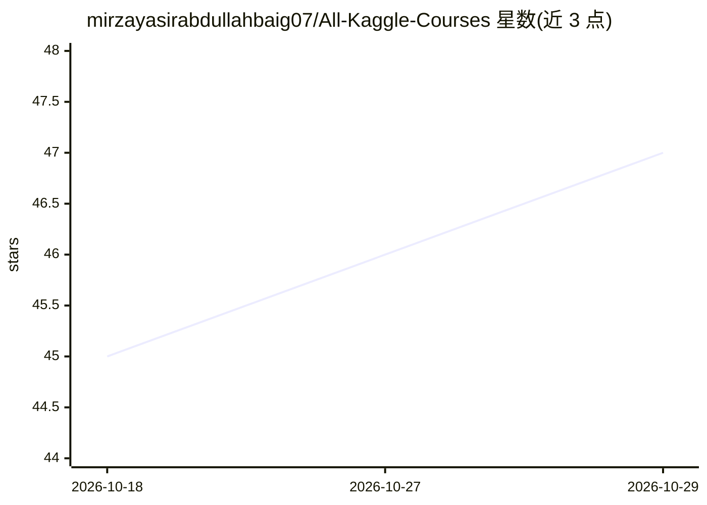

# mirzayasirabdullahbaig07/All-Kaggle-Courses

⭐ 47 · Jupyter Notebook · 推送 2026-04-22 · [GitHub](https://github.com/mirzayasirabdullahbaig07/All-Kaggle-Courses) · [官网](https://www.kaggle.com/myab07) · 个人维护

**个人 Kaggle 课程练习与解答合集，供数据科学学习者参考**

由个人学习者维护的 Kaggle 各课程练习仓库：收录学习过程中完成的练习、解答与注释，内容覆盖从基础概念到高级技术的数据科学课程（含深度学习、特征工程、pandas、时间序列等主题）。每个课程对应一个文件夹，内含练习与解答文件。仓库不提供安装运行流程，用户可浏览或克隆仓库用于自学，并欢迎提交建议与新练习。

## 筛选速览

| 维度 | 判定 | 备注 |
|---|---|---|
| AI 角色 | `ai-knowledge` | 知识聚合/清单类 |
| 许可风险 | `none` | — |
| 部署形态 | `None` |  |
| 模型依赖 | — | README 未给出锁定关系 |
| 硬件要求 | — | 无带数字的原话,不猜 |
| 安装摩擦 | `low` | 无编译、无系统依赖或容器化 |
| 成熟度 | — | 结构信号不足 |

## 能力要点

- 收录多门 Kaggle 课程的练习、解答与注释
- 按课程分文件夹组织
- 开放克隆与社区贡献

## 适用场景

- 自学数据科学时参考他人练习与解答
- 了解 Kaggle 各课程的练习内容
- 贡献自己的练习与他人交流

## 场景标签

`教程课程` · 领域:学习与行业

## 证据(README 行号)

> L3: Welcome to this repository! Here you will find a comprehensive collection of exercises done during various courses o
> L16: Each folder contains detailed exercises, solutions and annotations created during the learning journey. I hope this

## 星数曲线

2026-10-18 45 → 2026-10-29 47（+2）

---
*卡片 v1 · prompt 1.4 · 生成 2026-10-25 · 置信度 high · 依据 README sha `14397c55efd5` · [字段定义](../../DATASET.md)*
