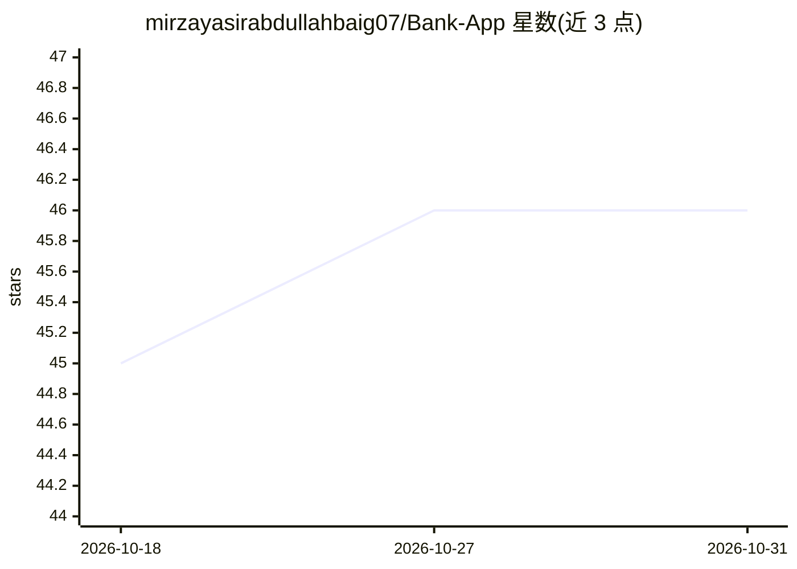

# mirzayasirabdullahbaig07/Bank-App

⭐ 46 · Python · 推送 2026-05-20 · [GitHub](https://github.com/mirzayasirabdullahbaig07/Bank-App) · [官网](https://bank-app-007.streamlit.app/) · 个人维护

**Streamlit 银行账户管理系统教学演示（开户/存取/查余额）**

基于 Python OOP 与 Streamlit 的银行账户管理系统模拟项目：支持创建账户、存款、取款、查询余额和查看账户详情，通过网页界面操作，用于演示类与对象、封装、方法与属性等面向对象编程概念。README 未包含任何模型训练或推理的功能说明；仓库主题标签含 ai/machine-learning，但正文未提及 AI 相关内容。作者声明仅用于教学，不可用于实际金融决策。

## 筛选速览

| 维度 | 判定 | 备注 |
|---|---|---|
| AI 角色 | `ai-enhanced` | 去掉 AI 部分产品仍成立 |
| 许可风险 | `none` | — |
| 部署形态 | `None` |  |
| 模型依赖 | — | README 未给出锁定关系 |
| 硬件要求 | — | 无带数字的原话,不猜 |
| 安装摩擦 | `low` | 无编译、无系统依赖或容器化 |
| 成熟度 | — | 结构信号不足 |

## 能力要点

- 创建账户、存款、取款、查询余额等模拟操作
- Streamlit 网页交互界面，提供在线 Demo 与视频演示
- 演示 Python OOP 概念（类与对象、封装、实例管理）

## 适用场景

- 学习 Python 面向对象编程的实践项目
- 参考 Streamlit 简单 Web 应用的构建方式

## 场景标签

 · 领域:教育/编程练习

## 证据(README 行号)

> L3: An **interactive Bank Account Management System** built using **Python (OOP)** and **Streamlit**.
> L4: This project simulates basic banking operations like creating accounts, depositing, withdrawing, and checking balanc

## 星数曲线

2026-10-18 45 → 2026-10-31 46（+1）

---
*卡片 v1 · prompt 1.4 · 生成 2026-10-25 · 置信度 low · 依据 README sha `029ff899ce94` · [字段定义](../../DATASET.md)*
