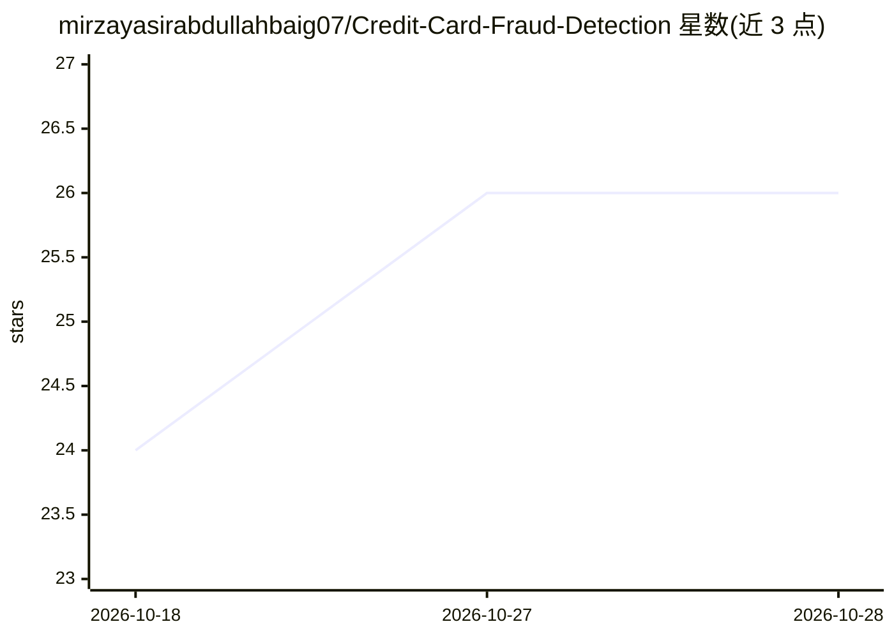

# mirzayasirabdullahbaig07/Credit-Card-Fraud-Detection

⭐ 27 · Python · 推送 2026-08-21 · [GitHub](https://github.com/mirzayasirabdullahbaig07/Credit-Card-Fraud-Detection) · [官网](https://credit-card-fraud-detection-model07.streamlit.app/) · 个人维护

**信用卡欺诈检测训练与部署全流程项目，Streamlit 在线预测应用**

包含训练到部署的完整流水线：在 Google Colab notebook 中训练 Logistic Regression 与 Random Forest 并对比（默认保存 Random Forest），用仅作用于训练集的 SMOTE 处理类别不平衡，输出模型与 RobustScaler 等 4 个 .pkl 文件；部署为 Streamlit Community Cloud 应用，提供单笔交易录入与 CSV 批量预测，带阈值调节和深色主题 UI。给想做欺诈检测演示或课程项目并上线应用的用户。

## 筛选速览

| 维度 | 判定 | 备注 |
|---|---|---|
| AI 角色 | `ai-native` | 本体是模型或模型工具 |
| 许可风险 | `none` | — |
| 部署形态 | `None` |  |
| 模型依赖 | — | README 未给出锁定关系 |
| 硬件要求 | — | 无带数字的原话,不猜 |
| 安装摩擦 | `low` | 无编译、无系统依赖或容器化 |
| 成熟度 | — | 结构信号不足 |

## 能力要点

- 训练 notebook 训练并对比 Logistic Regression 与 Random Forest
- SMOTE 仅用于训练集，测试集保持原分布
- Streamlit 应用支持单笔预测与 CSV 批量打分及阈值调节

## 适用场景

- 我想训练一个信用卡欺诈检测模型并部署成在线应用
- 对批量交易 CSV 打欺诈风险分并下载结果
- 调阈值权衡查全率与误报

## 场景标签

 · 领域:金融风控/机器学习

## 证据(README 行号)

> L11: |`app.py`|Streamlit app — single & batch fraud predictions, full custom UI|✅ Yes|
> L108: The notebook trains and compares **Logistic Regression** and

## 星数曲线

2026-10-18 24 → 2026-10-28 26（+2）

---
*卡片 v1 · prompt 1.4 · 生成 2026-10-27 · 置信度 high · 依据 README sha `53847ef41f23` · [字段定义](../../DATASET.md)*
