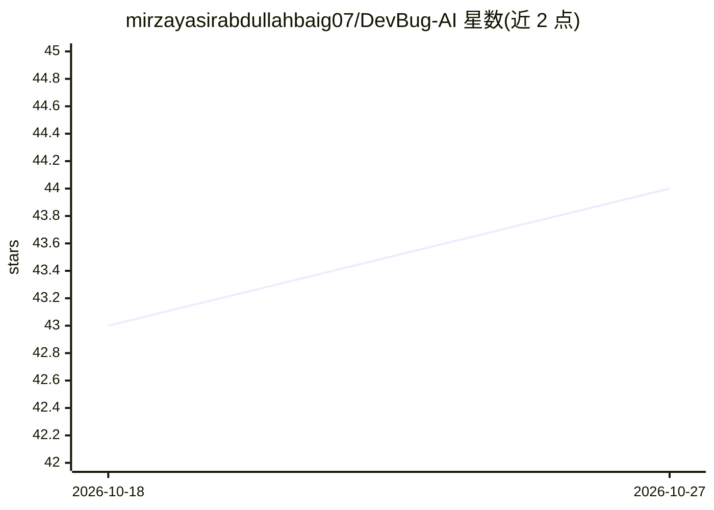

# mirzayasirabdullahbaig07/DevBug-AI

⭐ 44 · Python · 推送 2026-02-09 · [GitHub](https://github.com/mirzayasirabdullahbaig07/DevBug-AI) · [官网](https://devbug-ai.streamlit.app/) · 个人维护

**从缺陷报告文本预测缺陷类别并推荐合适开发者的 ML 工具**

统一的缺陷分类与开发者推荐系统：读取缺陷标题与描述，用 Scikit-learn 分类器预测缺陷类别，用 LightGBM 结合元数据与 Sentence Transformers (all-MiniLM-L6-v2) 文本嵌入推荐开发者，输出带概率的 Top-3 人选；未见过技术栈或领域映射为 Other。仓库附带 5 万条缺陷数据集、示例 Excel 与预训练模型文件，通过 Streamlit 网页界面交互，Python 3.9+ 运行，以 git clone 源码方式安装。

## 筛选速览

| 维度 | 判定 | 备注 |
|---|---|---|
| AI 角色 | `ai-native` | 本体是模型或模型工具 |
| 许可风险 | `none` | — |
| 部署形态 | `None` |  |
| 模型依赖 | — | README 未给出锁定关系 |
| 硬件要求 | — | 无带数字的原话,不猜 |
| 安装摩擦 | `low` | 无编译、无系统依赖或容器化 |
| 成熟度 | — | 结构信号不足 |

## 能力要点

- 基于标题/描述自动预测缺陷类别（Scikit-learn）
- 基于元数据与文本嵌入的开发者推荐（LightGBM）
- Top-3 开发者推荐并附概率
- 附带 50k 缺陷数据集与预训练模型文件

## 适用场景

- 团队根据缺陷描述快速分流缺陷类别
- 为新缺陷推荐有历史经验的开发者
- 作为可复现的 ML 流水线学习或二次开发起点

## 场景标签

 · 领域:软件工程/机器学习

## 证据(README 行号)

> L3: **DevBug-AI** is a unified bug classification and developer recommendation system. It helps classify software bugs i
> L13: - **Bug Classification:** Automatically predicts the category of a bug from its title and description.
> L14: - **Developer Recommendation:** Suggests the best developer for a bug based on metadata and text embeddings.

## 星数曲线

2026-10-18 43 → 2026-10-27 44（+1）

---
*卡片 v1 · prompt 1.4 · 生成 2026-10-25 · 置信度 high · 依据 README sha `d62f8146e0c5` · [字段定义](../../DATASET.md)*
