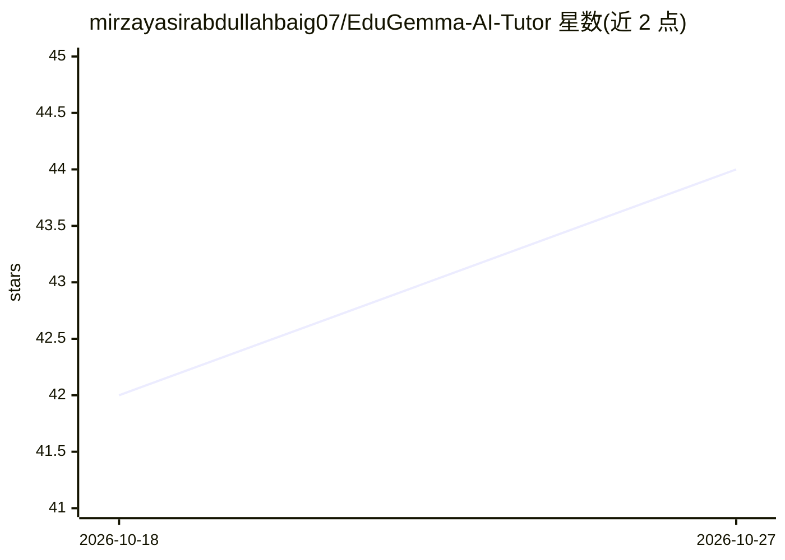

# mirzayasirabdullahbaig07/EduGemma-AI-Tutor

⭐ 44 · Jupyter Notebook · 推送 2026-05-06 · [GitHub](https://github.com/mirzayasirabdullahbaig07/EduGemma-AI-Tutor) · [官网](https://edugemma.netlify.app/) · 个人维护

**基于 Gemma 4 的离线自适应 AI 辅导应用，面向低资源地区学生**

为 Gemma 4 Good Hackathon 2026 构建的辅导代理，基于 google/gemma-4-9b-it，结合原生函数调用（课程检索、答案评估、练习卷生成三个工具）、多模态视觉（拍手写题识别）与 FAISS+OpenStax 的 RAG 检索，提供从小学到本科四级自适应难度。用 Unsloth QLoRA 微调 2B 模型并导出 GGUF，可在树莓派 5 离线运行。运行形式为 Kaggle notebook 与自包含 HTML 网页 demo；网页 demo 本身不含模型推理，微调权重标注赛后发布。

## 筛选速览

| 维度 | 判定 | 备注 |
|---|---|---|
| AI 角色 | `ai-native` | 本体是模型或模型工具 |
| 许可风险 | `none` | — |
| 部署形态 | `None` |  |
| 模型依赖 | local-ok | 支持本地模型 |
| 硬件要求 | `gpu-8g` | |
| 安装摩擦 | `low` | 无编译、无系统依赖或容器化 |
| 成熟度 | — | 结构信号不足 |

## 能力要点

- 三个 agent 工具：课程检索、答案评估、练习卷生成
- FAISS+OpenStax RAG 检索，索引约 45MB，完全离线
- Unsloth QLoRA 微调 Gemma 4 2B，Kaggle T4 上约 18 分钟，导出 GGUF 部署到 Ollama/树莓派
- 四级自适应难度（小学→本科），按滚动正确率自动升降级

## 适用场景

- 网络不可靠地区的学生离线一对一辅导
- 拍照上传手写题目，AI 讲解错误步骤
- 教师快速生成分层练习卷并跟踪学生薄弱知识点

## 场景标签

`多模态` · 领域:感知与多模态

## 证据(README 行号)

> L5: An offline-capable, adaptive AI tutoring agent built on `google/gemma-4-9b-it`. EduGemma combines Gemma 4's native f
> L22: |**Gemma 4 Native Function Calling**|Three agentic tools: `retrieve_curriculum`, `evaluate_answer`, `generate_pract
> L26: |**RAG (FAISS + OpenStax)**|Hallucination rate drops from ~18% to ~3% by grounding answers in curriculum|

## 星数曲线

2026-10-18 42 → 2026-10-27 44（+2）

---
*卡片 v1 · prompt 1.4 · 生成 2026-10-25 · 置信度 high · 依据 README sha `3925a7560ebb` · [字段定义](../../DATASET.md)*
